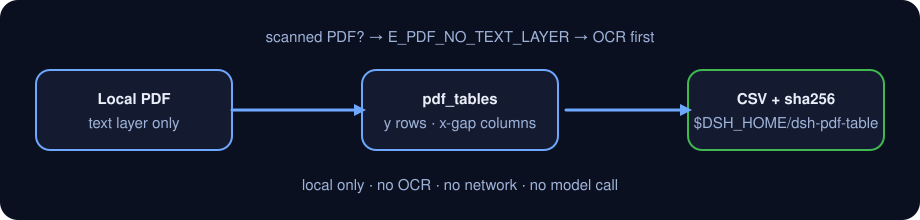

<div align="center">

# dsh-pdf-table

> **官方仓库。** 本包唯一官方仓库，由 PerryLink 维护；其他账号下的同名仓库与本项目无关。Apache-2.0。

[](https://www.npmjs.com/package/dsh-pdf-table)
[](https://github.com/PerryLink/dsh-pdf-table/actions)
[](LICENSE)

**从 PDF 文本层提取表格 → CSV。不做 OCR；扫描件不支持。**

> **状态：alpha / 公开合成 / partial / not counted / 非 GA。** 不含客户数据、客户证据，也不作生产可用声明。

[English](README.md) · [简体中文](README-zh.md)

```sh
dsh plugin --profile <profile> add dsh-pdf-table
```

</div>

## 一句话

把带文本层的 PDF 里的表格按坐标还原成行列，导出成带引号转义的 CSV。

> 只读文本层，不做 OCR。**扫描件（图片型 PDF）不支持，请先 OCR** 生成带文本层的 PDF 再运行。

## 适合 / 不适合

- **适合**：由 Word / Excel / 报表工具导出的、带文本层的 PDF；一页一张表或各页列结构一致的表；需要把表格落到 CSV 再做核对、入库或留档的场景。
- **不适合**：扫描件、拍照件、纯图片 PDF（没有文本层）；合并单元格、跨页跨行单元格、旋转页面、双栏/多栏正文混排；需要还原字体、颜色、边框或公式的版式分析；替代人工核对金额/单位。

## 输入

- 格式：本地 `.pdf` 文件路径，文件必须带文本层（可用 `pdf.inspect` 先检查）。
- 大小：建议单文件 ≤ 50 MB；页数不限，`pages` 可按 1-based 页码只选需要的页。
- 来源：用户自己指定的 PDF；原文件只读，不会被修改。
- **不支持扫描件**：没有文本层的 PDF 会返回 `E_PDF_NO_TEXT_LAYER`，提示“这是扫描件，请先 OCR”。

## 输出

- `pdf.inspect`：`{ pages, chars_per_page, total_chars, has_text_layer, pages_without_text }`。
- `pdf.tables`：`{ tables: [{ page, rows: string[][] }], rows }`；同一 y 的文本项成行，x 间隔聚类成列，行首/行尾空白会被清理。
- `pdf.to_csv`：CSV 文件路径、`sha256`、行数、字节数与导出的页码；文件写到 `$DSH_HOME/dsh-pdf-table/exports/`，原 PDF 不改。

## 示例

直接复制下面这句：

> 把这个 PDF 里的表格提取成 CSV，保留原来的行列结构。

用自带样例复跑并核对金标：

```sh
node samples/quickstart/run.mjs --check
```


样例 PDF 是代码生成的最小合成文件（3 行 × 4 列 + 一段说明文字），金标 `samples/quickstart/expected/result.json` 由 `node samples/quickstart/run.mjs --json` 真实产生，不是手写。截图就是上面这条命令的真实输出。

样例里的表头 `Q1 "units"` 和数据 `South, East` 故意包含引号与逗号，用来同时验证 CSV 的两种转义。

## 权限

读：用户指定的 PDF 文件（样例 `samples/quickstart/input/table-demo.pdf`）；不读其他目录。
写：`$DSH_HOME/dsh-pdf-table/exports/`（CSV 输出）；不改原 PDF。
联网：否。
外部系统：无。

`pdf.inspect`、`pdf.tables` 标 **R0**（只读）；`pdf.to_csv` 标 **R1**（本地写，只写 `$DSH_HOME/dsh-pdf-table` 下的 `exports/`）。可用 `DSH_PDF_TABLE_HOME` 覆盖本地写根目录（测试用），默认严格等于 `$DSH_HOME/dsh-pdf-table`。

## FAQ

### 1. 扫描件能用吗？

不能。本包只读 PDF 的文本层，**不做 OCR**。扫描件会报 `E_PDF_NO_TEXT_LAYER`，请先用 OCR 工具生成带文本层的 PDF，再运行 `pdf.inspect` 确认。

### 2. 表格列数对不上怎么办？

先跑 `node samples/quickstart/run.mjs --check` 排除环境问题。列边界靠文本项的 x 间隔聚类：如果单元格里有多段文字、列间距很小、或一页里有多张列结构不同的表，可能被合并或拆开。把 `pdf.tables` 的 `rows` 贴出来核对，必要时用 `pages` 只导出一页。

### 3. CSV 里的逗号和引号会坏吗？

不会。字段含逗号、双引号、CR/LF 时整体加双引号，内部双引号写成两个双引号（RFC 4180）。样例已覆盖 `South, East` 和 `Q1 "units"` 两种情况。

### 4. 会改我的 PDF 或上传数据吗？

不会。只读用户指定的 PDF；只在本地写 `$DSH_HOME/dsh-pdf-table/exports/`；不联网、不调用模型、不上传。

## 版本

`0.1.0` · 31 项测试通过（`node --test test/*.test.mjs`）。

> ⭐ 如果它帮到了你，点个 star 会让下一个人更容易找到它；没有任何功能被 star 解锁。



*工作流：本地 PDF → 文本层坐标聚类 → 本地 CSV；不调用模型。*

## 安装

```sh
dsh plugin --profile <profile> add dsh-pdf-table
dsh --profile <profile> --dump-config | grep dsh-pdf-table
```

卸载：

```sh
dsh plugin --profile <profile> remove dsh-pdf-table
```

### 安装通道

- **npm（推荐）:** `dsh plugin --profile <profile> add dsh-pdf-table`
- **git 通道:** `dsh plugin --profile <profile> add github:PerryLink/dsh-pdf-table`
- **tarball:** `pnpm pack`，然后 `dsh plugin --profile <profile> add ./dsh-pdf-table-<version>.tgz`

## 工具

工具名是稳定 API；说明保留英文以匹配运行时输出。

| 工具 | 用途 | 风险 |
|---|---|---|
| `pdf.inspect` | 页数、每页文本字符数、是否有文本层；无文本层报 `E_PDF_NO_TEXT_LAYER` | R0 |
| `pdf.tables` | 按 y 行聚类 + x 列间隔聚类提取表格，返回每页 `{ page, rows }` | R0 |
| `pdf.to_csv` | 把提取结果写成带引号转义的 CSV，返回路径与 sha256 | R1 local write |

### `pdf.tables` 的行列规则

1. 过滤空白文本项后，按 y 从大到小排序；y 差 ≤ 3pt 视为同一行。
2. 行内按 x 排序；相邻文本项 x 间隔 > 6pt 视为新单元格，否则合并。
3. 全页单元格的 x 起点按 18pt 容差聚类成列；短行用空字符串补齐。
4. 只有 1 个文本块的行视为正文，不当作表格行。

这是文本层启发式，不是版面分析引擎；边界见下文。

## 快速开始

```sh
# 1) 看页数与文本层
#    工具面：pdf.inspect({ path: "/abs/path/report.pdf" })

# 2) 提取表格
#    工具面：pdf.tables({ path: "/abs/path/report.pdf", pages: [1] })

# 3) 导出 CSV
#    工具面：pdf.to_csv({ path: "/abs/path/report.pdf", filename: "report.csv" })
```

用样例直接跑：

```sh
node samples/quickstart/run.mjs --check
```

## 验收证据

公开/合成 fixture 在 `samples/quickstart/`；`ACCEPTANCE.csv` 记录检查，除 quickstart 行外均为 `counted=false`。

| req_id | metric | threshold | actual | pass | source | counted |
|---|---|---|---|---|---|---|
| PDF-A02 | table 3x4 | 3 rows x 4 cols | 3 rows x 4 cols | true | public/synthetic | false |
| PDF-A04 | CSV quoting | comma+quote escaped | escaped | true | public/synthetic | false |
| PS1-QS01 | quickstart golden | 1/1 | 1 | true | synthetic/quickstart | true |

*这是 fixture 支撑的验收行，不是客户运行；没有编造输出。*

## 边界与已知限制

- **扫描件不支持**：只读文本层，不做 OCR；图片型 PDF 必须先 OCR。
- 只做坐标聚类：合并单元格、跨行单元格、旋转页面、竖排文本、多栏正文可能误判。
- 每页使用一套列边界：同一页多张列结构不同的表可能被并成一列集。
- 不做数值/单位/公式校验，不还原字体、颜色、边框。
- CSV 只做 RFC 4180 引号转义，不做 Excel 公式前缀清洗；不要用 Excel 直接打开来源不明的 CSV。
- 只在本机读写；不联网、不调用模型、不上传。
- 仅公开/合成样例；alpha/partial、not counted，不作 GA 或生产可用声明。

## 开发

```sh
pnpm install --frozen-lockfile
pnpm build && pnpm lint && pnpm typecheck
node --test test/*.test.mjs
node scripts/gate.mjs
```

## 兼容性

| 维度 | 状态 |
|---|---|
| Harness | `dsh >=0.2.1-rc.3 <0.4.0` |
| Node | `>=24.9.0 <25` |
| Platforms | All; local files only |
| 数据 | No network, no model call, no upload |

## 相关项目

- [dsh-ghg](https://github.com/PerryLink/dsh-ghg)（同样使用 pdfjs-dist 读文本层）
- [dsh-pim-lint](https://github.com/PerryLink/dsh-pim-lint)（CSV 校验类工具）
- [领域索引](https://perrylink.github.io/dsh-plugins/)

## 许可证

Apache-2.0. See `LICENSE`, `NOTICE`, `THIRD-PARTY-NOTICES`.
