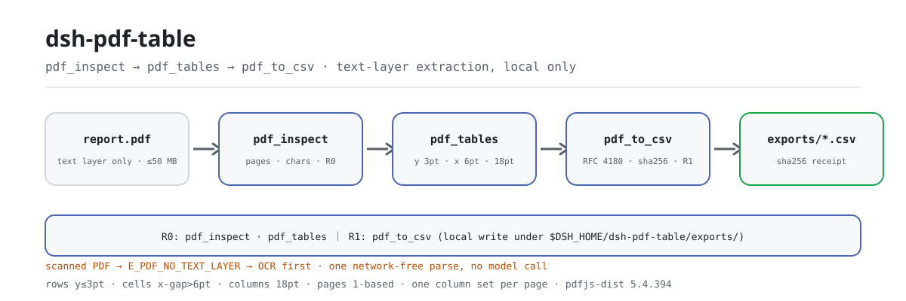

<div align="center">

<picture>
  <source media="(prefers-color-scheme: dark)" srcset="docs/assets/dsh-pdf-table-flow-dark.svg">
  
</picture>

# dsh-pdf-table

**Turn the table inside a text-layer PDF into rows and columns, then export a CSV you can reconcile.**

A local-only PDF table extractor for DeepSeek Harness: `pdf.inspect` checks for a text layer, `pdf.tables` rebuilds rows and columns from item coordinates, `pdf.to_csv` writes a quoted CSV — no network, no model call, no upload, and no OCR.

[Install](#three-step-setup) · [Configuration](#configuration) · [FAQ](#faq) · [简体中文](README.md) · [English](README.en.md) · [Español](README.es.md) · [Português](README.pt.md) · [हिन्दी](README.hi.md)

[](LICENSE)
[](#compatibility)
[](https://www.npmjs.com/package/dsh-pdf-table)
[](https://github.com/PerryLink/dsh-pdf-table/actions/workflows/ci.yml)
[](#compatibility)

[](https://github.com/PerryLink/dsh-pdf-table/stargazers)
[](https://www.npmjs.com/package/dsh-pdf-table)

```sh
dsh plugin --profile <profile> add dsh-pdf-table
```

</div>

<sub>Community plugin, not affiliated with DeepSeek. Canonical repository: <https://github.com/PerryLink/dsh-pdf-table> (no other official mirror).</sub>

<sub>Status: alpha / public-synthetic / partial / not counted / not GA. No customer data, customer evidence, or production-readiness claim.</sub>

## What it is

In one line: it reads the **text layer** of a local PDF, rebuilds the table from text-item coordinates, and exports a CSV with RFC 4180 quote escaping. It does not OCR, does not analyse layout, does not reconstruct fonts or borders, and does not check amounts or units for you — it only turns "text laid out in rows and columns on one page" into "a CSV someone else can reconcile".

- **Fits:** PDFs exported from Word, Excel or report writers that carry a real text layer; one table per page, or pages that share the same column layout; moving a table into CSV for reconciliation, loading or archiving.
- **Does not fit:** scans, photos and image-only PDFs (no text layer); merged cells, cells spanning pages, rotated pages, multi-column prose mixed with tables; layout reconstruction of fonts, colours, borders or formulas; replacing a human check of amounts or units.

```text
report.pdf ──pdf.inspect──▶ pages · chars_per_page · has_text_layer      (R0 read-only)
           ──pdf.tables──▶  rows[y][x]: y within 3pt = row, x gap > 6pt = cell  (R0 read-only)
           ──pdf.to_csv──▶  exports/*.csv + sha256 (RFC 4180 quoting)      (R1 local write)
```

The three tools form one local pipeline: no OCR, no network request, no model call, and the source PDF stays read-only throughout.

## Three-step setup

1. **Install** (pick one channel):

   ```sh
   # npm channel (recommended, published versions)
   dsh plugin --profile <profile> add dsh-pdf-table
   # git channel (latest main; equivalent to git+https://github.com/PerryLink/dsh-pdf-table.git)
   dsh plugin --profile <profile> add github:PerryLink/dsh-pdf-table
   # tarball channel: pnpm pack in this repo, then
   dsh plugin --profile <profile> add ./dsh-pdf-table-<version>.tgz
   ```

   The npm channel ships the compiled `lib/`; the git and tarball channels get the sources, and since this package has no `prepare` script you need `pnpm install && pnpm build` in the repo to produce `lib/` (build before packing a tarball too).

2. **Minimal config** (there are no Config keys; one mounted row is enough):

   ```yaml
   - insert:
       - id: dsh-pdf-table
         name: dsh-pdf-table
   ```

3. **Verify it works**:

   ```sh
   dsh --profile <profile> --dump-config | grep dsh-pdf-table
   node samples/quickstart/run.mjs --check
   ```

   The second command runs inside the repo; `quickstart ok` means extraction and CSV escaping are both fine.

**Uninstall**: `dsh plugin --profile <profile> remove dsh-pdf-table` (or remove the row from the profile patch).

## Core capabilities

Tool names are stable API; descriptions stay in English to match runtime output.

| Tool | Purpose | Risk |
|---|---|---|
| `pdf.inspect` | Page count, text characters per page, text-layer presence; no text layer raises `E_PDF_NO_TEXT_LAYER` | R0 |
| `pdf.tables` | Cluster text items by y into rows and x gaps into columns; returns `{ page, rows }` per page | R0 |
| `pdf.to_csv` | Write quoted CSV and return path + sha256 | R1 local write |

- **Text-layer coordinate clustering** — items on the same y (within 3pt) form a row, x gaps above 6pt start a new cell, and cell x starts cluster into columns with an 18pt tolerance; rows with a single text block are treated as prose and skipped.
- **Two risk levels** — `pdf.inspect` and `pdf.tables` are R0 (read-only); `pdf.to_csv` is R1 (local write) and always writes under `$DSH_HOME/dsh-pdf-table/exports/`.
- **Controlled export path** — the filename must match `[A-Za-z0-9._-]{1,120}`; `../`, path separators and symlink escapes are rejected (`E_PDF_PATH_INVALID` / `E_PDF_PATH_NOT_ALLOWED`).
- **CSV quote escaping** — fields containing a comma, a double quote, CR or LF are quoted, and embedded quotes are doubled (RFC 4180).
- **sha256 receipt** — `pdf.to_csv` returns the path, `sha256`, row count, byte count and the pages actually exported, so every field can be checked.
- **Errors carry the next action** — nine stable `E_PDF_*` codes, each rendered as one human sentence plus one next action; see "Error codes".

### Row/column rules used by `pdf.tables`

1. Drop whitespace-only items, sort by y descending; items within 3pt share a row.
2. Sort each row by x; gaps above 6pt start a new cell, smaller gaps merge.
3. Cluster cell x starts across the page with an 18pt tolerance; pad short rows.
4. Rows with a single text block are prose and are skipped.

This is a text-layer heuristic, not a layout-analysis engine; see the limits below. *Observed from `src/core/pdf.ts:274-276`*

## Input

- A local `.pdf` path. The file must have a text layer; run `pdf.inspect` first if unsure.
- A single file up to roughly 50 MB is a sensible local limit (a recommendation, not a hard threshold in code). `pages` selects 1-based pages.
- The PDF is read-only and never modified.
- **Scanned PDFs are not supported**: a missing text layer raises `E_PDF_NO_TEXT_LAYER` and asks for OCR.

## Output

- `pdf.inspect`: `{ pages, chars_per_page, total_chars, has_text_layer, pages_without_text }`.
- `pdf.tables`: `{ tables: [{ page, rows: string[][] }], rows }`; items on the same y form a row, x gaps define columns, and cell text is trimmed.
- `pdf.to_csv`: `{ path, sha256, rows, bytes, pages }`. The file goes to `$DSH_HOME/dsh-pdf-table/exports/` with the default name `pdf-tables-<first 12 sha256 chars>.csv`; the source PDF is untouched.

## Example

Paste this one line into the agent:

```text
把这个 PDF 里的表格提取成 CSV，保留原来的行列结构。
```

Reproduce the bundled sample and compare with the golden file:

```sh
node samples/quickstart/run.mjs --check
```

Real output (screenshot: [`docs/assets/quickstart.png`](docs/assets/quickstart.png); raw log: [`docs/assets/quickstart.log`](docs/assets/quickstart.log)):

```text
dsh-pdf-table quickstart - synthetic text-layer PDF (no OCR, not customer data)
1 page, 138 text chars; text layer yes
table: 3 rows x 4 columns on page 1
header: Region | Q1 "units" | Q2 | Q3
row: North | 120 | 135 | 150
row: South, East | 90 | 110 | 130
CSV exports/table-demo.csv: 3 rows, 71 bytes, sha256 c5826d3772fb...
CSV escaping: comma -> "South, East"; quote -> "Q1 ""units"""
golden samples/quickstart/expected/result.json matches
quickstart ok
```


The exported CSV is exactly the `csv.text` field of the golden file `samples/quickstart/expected/result.json`:

```csv
Region,"Q1 ""units""",Q2,Q3
North,120,135,150
"South, East",90,110,130
```

The sample PDF is a tiny code-generated file: a 3-row × 4-column table plus one prose line. The header `Q1 "units"` and the cell `South, East` deliberately exercise both CSV quote rules; the prose line is dropped by the "single text block = prose" rule. `samples/quickstart/expected/result.json` is the real stdout of `node samples/quickstart/run.mjs --json`, not hand-written.

Tool-surface calls:

```sh
# 1) page count + text layer
#    tool surface: pdf.inspect({ path: "/abs/path/report.pdf" })

# 2) extract table rows
#    tool surface: pdf.tables({ path: "/abs/path/report.pdf", pages: [1] })

# 3) export CSV
#    tool surface: pdf.to_csv({ path: "/abs/path/report.pdf", filename: "report.csv" })
```

## Configuration

This plugin has **no Config keys** — after mounting, everything is available, and the only thing you can change is that one row in the profile patch. All tuning knobs live on the three tools' arguments:

| Tool | Argument | Required | Meaning |
|---|---|---|---|
| `pdf.inspect` | `path` | yes | Absolute path of the PDF to inspect |
| `pdf.tables` | `path` | yes | Absolute path of the PDF to extract |
| `pdf.tables` | `pages` | no | 1-based page array; omitted = every page; an empty array or out-of-range page raises `E_PDF_PAGE_RANGE` |
| `pdf.to_csv` | `path` | yes | Absolute path of the PDF to export |
| `pdf.to_csv` | `pages` | no | Same as above |
| `pdf.to_csv` | `filename` | no | Export filename, `[A-Za-z0-9._-]{1,120}` only; default `pdf-tables-<first 12 sha256 chars>.csv` |

Local write root: `$DSH_HOME/dsh-pdf-table` (exports land in its `exports/`). Tests can override it with `DSH_PDF_TABLE_HOME`; when `DSH_HOME` is unset the plugin falls back to the current working directory (`process.cwd()/dsh-pdf-table`) — *Observed from `src/plugin/index.ts:9-14`*.

## FAQ

<details>
<summary>Can it read a scanned PDF?</summary>

No. This package reads the text layer and **does not OCR**. An image-only PDF fails with `E_PDF_NO_TEXT_LAYER`; OCR it first, then run `pdf.inspect` again and check `total_chars > 0`.

</details>

<details>
<summary>Why is a column merged or split?</summary>

First run `node samples/quickstart/run.mjs --check` to rule out an environment problem. Columns come from x gaps between text items: narrow gaps, several text runs inside one cell, or two tables with different layouts on the same page can merge or split columns. Inspect the `rows` from `pdf.tables` and use `pages` to export one page at a time when needed.

</details>

<details>
<summary>Are commas and quotes in cells safe?</summary>

Yes. Fields containing a comma, a double quote, CR or LF are quoted and embedded quotes are doubled (RFC 4180). The sample covers both `South, East` and `Q1 "units"`. Note that this package only does quote escaping — it does not sanitise Excel formula prefixes.

</details>

<details>
<summary>Does it modify or upload my PDF?</summary>

No. It reads the named PDF, writes only under `$DSH_HOME/dsh-pdf-table/exports/`, and never uses the network or a model call. The source PDF's sha256 is only used to build the default filename; nothing is written back to the file.

</details>

<details>
<summary>What does it cost in performance?</summary>

Every call reads the PDF into memory and parses the text layer with the local pdfjs-dist, with no caching, so the cost grows with page and text-item counts. There is no network request, model call or background process, so idle cost is zero. The repo publishes no timing benchmark, and 50 MB should not be treated as a hard cap — split the file or use `pages` if memory is tight.

</details>

## Security boundaries

- **The source PDF is read-only.** `openPdf` only reads the bytes and computes `sha256`; no success or failure path writes back to the source file.
- **One write surface.** `pdf.to_csv` always writes to `$DSH_HOME/dsh-pdf-table/exports/`; the filename passes a whitelist and the resolved path is re-checked through `realpath`, so a symlink cannot redirect the write outside the export directory.
- **No network, no model call.** Parsing happens in-process (pdfjs-dist `5.4.394`): no fetch, no external service, no model call.
- **Fails closed.** No text layer, corrupt file, empty file, encryption, out-of-range pages and write failures all raise a stable error code with a next action instead of silently returning an empty table.
- **Registration is an effect.** The three tools are registered in `apply()` and removed on stop or hot reload.

## Permissions & data

Read: the PDF the user names (sample: `samples/quickstart/input/table-demo.pdf`); nothing else.
Write: `$DSH_HOME/dsh-pdf-table/exports/` only; the source PDF is not modified.
Network: no.
External systems: none.

`pdf.inspect` and `pdf.tables` are **R0** (read-only); `pdf.to_csv` is **R1** (local write, only under `$DSH_HOME/dsh-pdf-table/exports/`). `DSH_PDF_TABLE_HOME` can override the local write root for tests; the default is exactly `$DSH_HOME/dsh-pdf-table`.

## Error codes

| Code | When it appears | Next action |
|---|---|---|
| `E_PDF_PATH_INVALID` | Empty path, a directory, an unreadable path, or an unsafe export filename | Pass an existing absolute `.pdf` path; export only `[A-Za-z0-9._-]` filenames |
| `E_PDF_NOT_FOUND` | The file does not exist | Check spelling and case of the path |
| `E_PDF_EMPTY` | Zero-byte file, or a PDF with zero pages | Use a non-empty, uncorrupted PDF |
| `E_PDF_CORRUPT` | Truncated or incomplete file, or a `.pdf` that is not a PDF | Open it in a reader and "save as" a fresh PDF, then retry |
| `E_PDF_ENCRYPTED` | Password-protected, so the text layer is unreadable | Export a password-free copy with the owner password (this package never guesses passwords) |
| `E_PDF_NO_TEXT_LAYER` | Scanned/image-only PDF with no extractable characters | OCR it into a text PDF first, then run again |
| `E_PDF_PAGE_RANGE` | `pages` is empty, not a positive integer, out of range, or an invalid single page | Start at 1 and use the `pages` value returned by `pdf.inspect` |
| `E_PDF_PATH_NOT_ALLOWED` | The export path escapes `exports/` (also after realpath) | Pass a bare filename without `../`, path separators or symlinks |
| `E_PDF_EXPORT_FAILED` | Local write failed: unwritable directory, disk full, etc. | Make sure `$DSH_HOME/dsh-pdf-table` is writable, then retry |

Every message carries one human sentence, a stable code and one next action. Per-code troubleshooting: [TROUBLESHOOTING.md](TROUBLESHOOTING.md).

## Acceptance evidence

Public/synthetic fixtures live in `samples/quickstart/`; `ACCEPTANCE.csv` records the checks. Every row is `counted=false` except the quickstart row.

| req_id | metric | threshold | actual | pass | source | counted |
|---|---|---|---|---|---|---|
| PDF-A01 | inspect pages/chars | pages=1 chars>0 | pages=1 chars=129 | true | public/synthetic | false |
| PDF-A02 | table 3x4 | 3 rows x 4 cols | 3 rows x 4 cols | true | public/synthetic | false |
| PDF-A03 | page filter | page 2 only | pages=2 | true | public/synthetic | false |
| PDF-A04 | CSV quoting | comma+quote escaped | escaped | true | public/synthetic | false |
| PDF-A05 | CSV sha256 | matches file | c5826d3772fb | true | public/synthetic | false |
| PDF-A06 | scanned PDF error | E_PDF_NO_TEXT_LAYER | E_PDF_NO_TEXT_LAYER | true | public/synthetic | false |
| PDF-A07 | corrupt PDF error | E_PDF_CORRUPT | E_PDF_CORRUPT | true | public/synthetic | false |
| PDF-A08 | empty PDF error | E_PDF_EMPTY | E_PDF_EMPTY | true | public/synthetic | false |
| PDF-A09 | export path safety | traversal rejected | E_PDF_PATH_INVALID | true | public/synthetic | false |
| PS1-QS01 | quickstart golden | 1/1 | 1 | true | synthetic/quickstart | true |

*Fixture-backed rows, not a customer run; no output is invented.*

## Known limitations

- **No OCR:** image-only PDFs must be OCR'd first.
- Coordinate clustering only: merged cells, cross-page cells, rotated pages, vertical text and multi-column prose may be misread.
- One column set per page: two differently shaped tables on the same page can be merged into one column set.
- No numeric/unit/formula validation; fonts, colours and borders are not reconstructed.
- CSV uses RFC 4180 quote escaping only; Excel formula prefixes are not sanitised.
- Local only: no network, no model call, no upload.
- Public/synthetic samples only; alpha/partial, not counted, no GA or production-readiness claim.

## Interoperability

- **Depends on the `tools` service only** (`inject = ['tools']`): the plugin loads when the profile composes tools, and it provides no service keys, so service-key conflicts are impossible.
- **Tool names carry a `pdf.` prefix**: no bare built-in name is taken. If another plugin also registers `pdf.*` tools, that is a real name collision — check the tool surface with `dsh --profile <profile> --dump-config` before installing.
- **No browser half**: the manifest declares no `dsh.client` (`scripts/lint.mjs` asserts `!pkg.dsh?.client`), so it registers no client slot and does not compete for UI seats.
- **No HTTP routes**: it registers no `webServer` prefix and listens on no port.
- **The patch only inserts itself**: `cordis.patch.yml` has a single `insert` row; it never overwrites built-in rows or mutates globals.

## Compatibility

| Surface | Status |
|---|---|
| Harness | `dsh >=0.2.1-rc.3 <0.4.0` |
| Node | `>=24.9.0 <25` |
| Platforms | All; local files only |
| Data | No network, no model call, no upload |

## Ecosystem & quality

- [Domain index](https://perrylink.github.io/dsh-plugins/) (family overview, task-based browsing and package versions)
- [npm package page](https://www.npmjs.com/package/dsh-pdf-table) (version, downloads and dependency)
- [GitHub repository](https://github.com/PerryLink/dsh-pdf-table) (issues, Actions and releases)
- Runtime dependency [pdfjs-dist](https://www.npmjs.com/package/pdfjs-dist) `5.4.394` (local text-layer parsing only, no network request)

## Related work

- [dsh-ghg](https://github.com/PerryLink/dsh-ghg) (also reads PDF text with pdfjs-dist)
- [dsh-pim-lint](https://github.com/PerryLink/dsh-pim-lint) (CSV validation tools)

## Development

```sh
pnpm install --frozen-lockfile
pnpm build && pnpm lint && pnpm typecheck
node --test test/*.test.mjs
node scripts/gate.mjs
```

Current version `0.1.0`, 31 tests pass (`node --test test/*.test.mjs`). Release gate: `node scripts/gate.mjs` (metadata lint + every public acceptance row).

| Path | Contents |
|---|---|
| `src/core/pdf.ts` | pdfjs loading, text items, row/column clustering, nine stable error codes |
| `src/core/csv.ts` | RFC 4180 field escaping and CSV assembly |
| `src/core/safe-path.ts` | Export filename whitelist and directory-escape checks |
| `src/plugin/index.ts` | `resolveBaseDir` (`DSH_PDF_TABLE_HOME` / `DSH_HOME`) and `apply` |
| `src/plugin/tools.ts` | The `pdf.inspect` / `pdf.tables` / `pdf.to_csv` tool surface |
| `test/*.test.mjs` | 31 `node --test` cases (CSV, PDF, paths, plugin smoke, quickstart) |
| `samples/quickstart/` | Synthetic PDF, golden `expected/result.json` and the replay script |
| `docs/assets/` | Diagrams plus the real terminal output (`quickstart.png` / `quickstart.log`) |

The opening hero is generated by [`scripts/gen-readme-assets.py`](scripts/gen-readme-assets.py) (Python standard library, pure SVG, command-token copy, light and dark pair) and is reproducible: `python scripts/gen-readme-assets.py`. `docs/assets/quickstart.png` is a real run screenshot kept together with `docs/assets/quickstart.log`; the older single-theme `docs/assets/dsh-pdf-table-flow.svg` is kept so old links never 404, while the README uses the light/dark pair.

Topics: `dsh`, `dsh-plugin`, `deepseek-harness`, `deepseek`, `pdf`, `table`, `csv`, `pdfjs`, `perrylink`

## Family & thanks

This project is a member of the DeepSeek Harness plugin family maintained by [PerryLink](https://github.com/PerryLink) (all Apache-2.0). If this plugin helps you, **give it a star** — it unlocks nothing, but it makes the next person find it faster.

- [@PerryLink](https://github.com/PerryLink) — creator and maintainer: text-layer coordinate clustering, the three-tool surface, the quickstart golden sample and the five-language docs.

## License

[LICENSE](LICENSE) (Apache License 2.0) © 2026 dsh-pdf-table contributors. See also `NOTICE` and `THIRD-PARTY-NOTICES`.

<p align="center"><sub>Apache-2.0 · Community plugin, not affiliated with DeepSeek.</sub></p>
