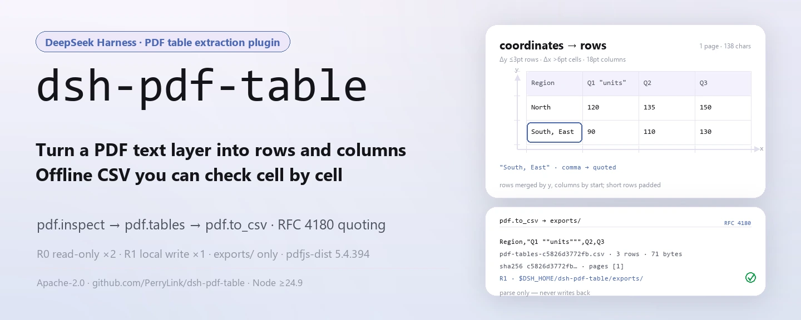
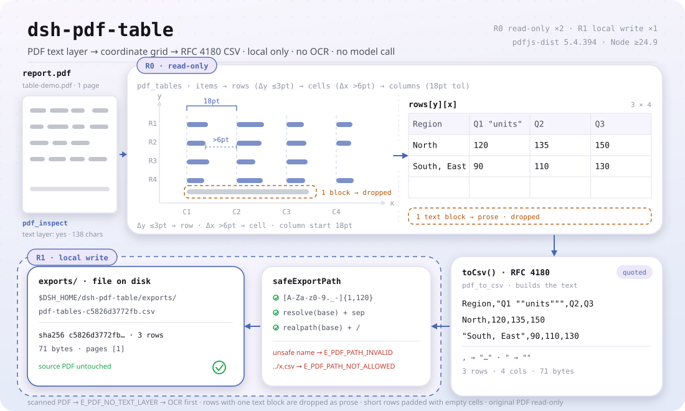
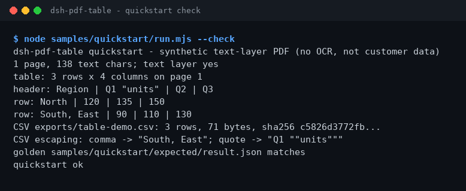

<div align="center">

<picture>
  <source media="(prefers-color-scheme: dark)" srcset="docs/assets/dsh-pdf-table-hero-en-dark.webp">
  
</picture>

# dsh-pdf-table

**Convierte la tabla de un PDF con capa de texto en filas y columnas, y exporta un CSV que puedes conciliar.**

Extractor de tablas de PDF totalmente local para DeepSeek Harness: `pdf.inspect` comprueba si hay capa de texto, `pdf.tables` reconstruye filas y columnas a partir de las coordenadas y `pdf.to_csv` escribe un CSV con entrecomillado — sin red, sin llamada al modelo, sin subir nada y sin OCR.

[Instalar](#instalación-en-tres-pasos) · [Configuración](#configuración) · [FAQ](#faq) · [简体中文](README.md) · [English](README.en.md) · [Español](README.es.md) · [Português](README.pt.md) · [हिन्दी](README.hi.md)

[](LICENSE)
[](#compatibilidad)
[](https://www.npmjs.com/package/dsh-pdf-table)
[](https://github.com/PerryLink/dsh-pdf-table/actions/workflows/ci.yml)
[](#compatibilidad)

[](https://github.com/PerryLink/dsh-pdf-table/stargazers)
[](https://www.npmjs.com/package/dsh-pdf-table)

```sh
dsh plugin --profile <profile> add dsh-pdf-table
```

</div>

<sub>Plugin de la comunidad, no afiliado a DeepSeek. Repositorio canónico: <https://github.com/PerryLink/dsh-pdf-table> (no hay otro espejo oficial).</sub>

<sub>Estado: alpha / public-synthetic / partial / not counted / no GA. Sin datos de clientes, sin evidencia de clientes y sin declaración de disponibilidad para producción.</sub>

## Qué es

En una frase: lee la **capa de texto** de un PDF local, reconstruye la tabla a partir de las coordenadas de los fragmentos de texto y exporta un CSV con entrecomillado RFC 4180. No hace OCR, no analiza el diseño de página, no reconstruye fuentes ni bordes y no comprueba importes ni unidades por ti: solo convierte «texto dispuesto en filas y columnas en una página» en «un CSV que otra persona puede conciliar».

<picture>
  <source media="(prefers-color-scheme: dark)" srcset="docs/assets/dsh-pdf-table-flow-v5-dark.svg">
  6pt y sus inicios se agrupan con tolerancia de 18pt en las columnas C1-C4; las filas cortas se rellenan y una fila de un solo bloque se descarta como prosa, dando una rejilla rows[y][x] de 3x4. toCsv() aplica el entrecomillado RFC 4180, el texto cruza la frontera de escritura R1 por safeExportPath (lista blanca de nombre + realpath) hasta $DSH_HOME/dsh-pdf-table/exports/ y vuelve con un recibo sha256">
</picture>

- **Encaja:** PDF exportados desde Word, Excel o generadores de informes que llevan una capa de texto real; una tabla por página, o páginas que comparten la misma estructura de columnas; pasar una tabla a CSV para conciliar, cargar o archivar.
- **No encaja:** escaneos, fotos y PDF solo de imagen (sin capa de texto); celdas combinadas, celdas que cruzan páginas, páginas giradas, prosa a dos columnas mezclada con tablas; reconstrucción de fuentes, colores, bordes o fórmulas; sustituir la revisión humana de importes o unidades.

```text
report.pdf ──pdf.inspect──▶ pages · chars_per_page · has_text_layer      (R0 solo lectura)
           ──pdf.tables──▶  rows[y][x]: y a 3pt = fila, hueco x > 6pt = celda  (R0 solo lectura)
           ──pdf.to_csv──▶  exports/*.csv + sha256 (entrecomillado RFC 4180)  (R1 escritura local)
```

Las tres herramientas forman una única tubería local: sin OCR, sin peticiones de red, sin llamada al modelo y con el PDF original en solo lectura de principio a fin.

## Instalación en tres pasos

1. **Instalar** (elige un canal):

   ```sh
   # canal npm (recomendado, versiones publicadas)
   dsh plugin --profile <profile> add dsh-pdf-table
   # canal git (última main; equivale a git+https://github.com/PerryLink/dsh-pdf-table.git)
   dsh plugin --profile <profile> add github:PerryLink/dsh-pdf-table
   # canal tarball: tras pnpm pack en este repositorio
   dsh plugin --profile <profile> add ./dsh-pdf-table-<version>.tgz
   ```

   El canal npm incluye el `lib/` compilado; los canales git y tarball traen el código fuente y, como este paquete no tiene script `prepare`, necesitas `pnpm install && pnpm build` en el repositorio para generar `lib/` (también antes de empaquetar un tarball).

2. **Configuración mínima** (no hay claves Config; basta con una fila montada):

   ```yaml
   - insert:
       - id: dsh-pdf-table
         name: dsh-pdf-table
   ```

3. **Comprobar que funciona**:

   ```sh
   dsh --profile <profile> --dump-config | grep dsh-pdf-table
   node samples/quickstart/run.mjs --check
   ```

   El segundo comando se ejecuta dentro del repositorio; si imprime `quickstart ok`, la extracción y el entrecomillado del CSV son correctos.

**Desinstalar**: `dsh plugin --profile <profile> remove dsh-pdf-table` (o elimina la fila del patch del perfil).

## Capacidades clave

Los nombres de las herramientas son API estable; las descripciones se mantienen en inglés para coincidir con la salida en tiempo de ejecución.

| Herramienta | Uso | Riesgo |
|---|---|---|
| `pdf.inspect` | Número de páginas, caracteres de texto por página y presencia de capa de texto; sin capa de texto lanza `E_PDF_NO_TEXT_LAYER` | R0 |
| `pdf.tables` | Agrupa los fragmentos por y en filas y por huecos de x en columnas; devuelve `{ page, rows }` por página | R0 |
| `pdf.to_csv` | Escribe el CSV entrecomillado y devuelve la ruta y el sha256 | R1 escritura local |

- **Agrupación por coordenadas de la capa de texto** — los fragmentos en la misma y (≤3pt) forman una fila, los huecos de x superiores a 6pt abren una celda nueva y los inicios de celda se agrupan en columnas con una tolerancia de 18pt; las filas con un solo bloque de texto se tratan como prosa y se descartan.
- **Dos niveles de riesgo** — `pdf.inspect` y `pdf.tables` son R0 (solo lectura); `pdf.to_csv` es R1 (escritura local) y siempre escribe bajo `$DSH_HOME/dsh-pdf-table/exports/`.
- **Ruta de exportación controlada** — el nombre de archivo debe cumplir `[A-Za-z0-9._-]{1,120}`; `../`, los separadores de ruta y las fugas por enlace simbólico se rechazan (`E_PDF_PATH_INVALID` / `E_PDF_PATH_NOT_ALLOWED`).
- **Entrecomillado CSV** — los campos con coma, comilla doble, CR o LF se entrecomillan y las comillas internas se duplican (RFC 4180).
- **Recibo sha256** — `pdf.to_csv` devuelve la ruta, el `sha256`, el número de filas, los bytes y las páginas realmente exportadas, para poder verificarlo todo.
- **Errores con el siguiente paso** — nueve códigos `E_PDF_*` estables, con la forma `<una frase humana>（E_PDF_XXX）｜下一步：<una acción>`; consulta «Códigos de error».

### Reglas de filas y columnas de `pdf.tables`

1. Se descartan los fragmentos en blanco y se ordenan por y descendente; los que están a ≤3pt comparten fila.
2. Cada fila se ordena por x; un hueco superior a 6pt abre una celda nueva y los menores se fusionan.
3. Los inicios de celda de toda la página se agrupan en columnas con tolerancia de 18pt; las filas cortas se rellenan.
4. Las filas con un solo bloque de texto son prosa y se omiten.

Es una heurística sobre la capa de texto, no un motor de análisis de diseño; los límites están más abajo. *Observed from `src/core/pdf.ts:274-276`*

## Entrada

- Ruta local de un `.pdf`. El archivo debe tener capa de texto; si dudas, ejecuta antes `pdf.inspect`.
- Un solo archivo de hasta unos 50 MB es un límite local razonable (una recomendación, no un umbral fijo en el código). `pages` selecciona páginas con base 1.
- El PDF es de solo lectura y nunca se modifica.
- **Los PDF escaneados no son compatibles**: la falta de capa de texto lanza `E_PDF_NO_TEXT_LAYER` y pide OCR.

## Salida

- `pdf.inspect`: `{ pages, chars_per_page, total_chars, has_text_layer, pages_without_text }`.
- `pdf.tables`: `{ tables: [{ page, rows: string[][] }], rows }`; los fragmentos de la misma y forman una fila, los huecos de x definen columnas y el texto de cada celda se recorta.
- `pdf.to_csv`: `{ path, sha256, rows, bytes, pages }`. El archivo va a `$DSH_HOME/dsh-pdf-table/exports/` con el nombre por defecto `pdf-tables-<12 primeros caracteres del sha256>.csv`; el PDF original no se toca.

## Ejemplo

Pega esta línea en el agente:

```text
把这个 PDF 里的表格提取成 CSV，保留原来的行列结构。
```

Reproduce el ejemplo incluido y compáralo con el archivo dorado:

```sh
node samples/quickstart/run.mjs --check
```

Salida real (captura: [`docs/assets/quickstart.png`](docs/assets/quickstart.png); registro: [`docs/assets/quickstart.log`](docs/assets/quickstart.log)):

```text
dsh-pdf-table quickstart - synthetic text-layer PDF (no OCR, not customer data)
1 page, 138 text chars; text layer yes
table: 3 rows x 4 columns on page 1
header: Region | Q1 "units" | Q2 | Q3
row: North | 120 | 135 | 150
row: South, East | 90 | 110 | 130
CSV exports/table-demo.csv: 3 rows, 71 bytes, sha256 c5826d3772fb...
CSV escaping: comma -> "South, East"; quote -> "Q1 ""units"""
golden samples/quickstart/expected/result.json matches
quickstart ok
```



El CSV exportado es exactamente el campo `csv.text` del archivo dorado `samples/quickstart/expected/result.json`:

```csv
Region,"Q1 ""units""",Q2,Q3
North,120,135,150
"South, East",90,110,130
```

El PDF de ejemplo es un archivo mínimo generado por código: una tabla de 3 filas × 4 columnas más una línea de prosa. La cabecera `Q1 "units"` y la celda `South, East` contienen a propósito comillas y comas para ejercitar las dos reglas de entrecomillado del CSV; la línea de prosa se descarta por la regla «un solo bloque de texto = prosa». El dorado es la salida real de `node samples/quickstart/run.mjs --json`, no está escrito a mano.

Llamadas a la superficie de herramientas:

```sh
# 1) número de páginas y capa de texto
#    superficie: pdf.inspect({ path: "/abs/path/report.pdf" })

# 2) extraer filas de la tabla
#    superficie: pdf.tables({ path: "/abs/path/report.pdf", pages: [1] })

# 3) exportar CSV
#    superficie: pdf.to_csv({ path: "/abs/path/report.pdf", filename: "report.csv" })
```

## Configuración

Este plugin **no tiene claves Config**: tras montarlo todo está disponible y lo único modificable es esa fila del patch del perfil. Todos los ajustes viven en los argumentos de las tres herramientas:

| Herramienta | Argumento | Obligatorio | Significado |
|---|---|---|---|
| `pdf.inspect` | `path` | sí | Ruta absoluta del PDF a inspeccionar |
| `pdf.tables` | `path` | sí | Ruta absoluta del PDF a extraer |
| `pdf.tables` | `pages` | no | Array de páginas con base 1; si se omite, todas; un array vacío o una página fuera de rango lanza `E_PDF_PAGE_RANGE` |
| `pdf.to_csv` | `path` | sí | Ruta absoluta del PDF a exportar |
| `pdf.to_csv` | `pages` | no | Igual que arriba |
| `pdf.to_csv` | `filename` | no | Nombre de exportación, solo `[A-Za-z0-9._-]{1,120}`; por defecto `pdf-tables-<12 primeros caracteres del sha256>.csv` |

Raíz de escritura local: `$DSH_HOME/dsh-pdf-table` (se exporta a su `exports/`). En pruebas se puede sobrescribir con `DSH_PDF_TABLE_HOME`; si `DSH_HOME` no está definida, el plugin usa el directorio de trabajo actual (`process.cwd()/dsh-pdf-table`): *Observed from `src/plugin/index.ts:9-14`*.

## FAQ

<details>
<summary>¿Puede leer un PDF escaneado?</summary>

No. Este paquete lee la capa de texto y **no hace OCR**. Un PDF solo de imagen falla con `E_PDF_NO_TEXT_LAYER`; pásalo primero por OCR y vuelve a ejecutar `pdf.inspect` para confirmar que `total_chars > 0`.

</details>

<details>
<summary>¿Por qué se une o se separa una columna?</summary>

Primero ejecuta `node samples/quickstart/run.mjs --check` para descartar un problema de entorno. Las columnas salen de los huecos de x entre fragmentos: huecos estrechos, varios fragmentos dentro de una celda o dos tablas con diseños distintos en la misma página pueden unir o separar columnas. Revisa las `rows` de `pdf.tables` y usa `pages` para exportar de una en una cuando haga falta.

</details>

<details>
<summary>¿Son seguras las comas y comillas dentro de las celdas?</summary>

Sí. Los campos con coma, comilla doble, CR o LF se entrecomillan y las comillas internas se duplican (RFC 4180). El ejemplo cubre `South, East` y `Q1 "units"`. Ojo: este paquete solo hace entrecomillado, no limpia prefijos de fórmula de Excel.

</details>

<details>
<summary>¿Modifica o sube mi PDF?</summary>

No. Lee el PDF indicado, escribe solo bajo `$DSH_HOME/dsh-pdf-table/exports/` y nunca usa la red ni llama a un modelo. El sha256 del PDF original solo sirve para construir el nombre por defecto; no se escribe nada en el archivo.

</details>

<details>
<summary>¿Cuánto cuesta en rendimiento?</summary>

Cada llamada lee el PDF en memoria y analiza la capa de texto con pdfjs-dist local, sin caché, así que el coste crece con el número de páginas y de fragmentos. No hay peticiones de red, llamadas al modelo ni procesos en segundo plano, por lo que el coste en reposo es cero. El repositorio no publica un benchmark de tiempos y 50 MB no debería tratarse como tope duro: divide el archivo o usa `pages` si la memoria aprieta.

</details>

## Límites de seguridad

- **El PDF original es de solo lectura.** `openPdf` solo lee los bytes y calcula el `sha256`; ninguna ruta, con éxito o con error, reescribe el archivo de origen.
- **Una sola superficie de escritura.** `pdf.to_csv` escribe siempre en `$DSH_HOME/dsh-pdf-table/exports/`; el nombre pasa una lista blanca y la ruta resuelta se revisa con `realpath`, así que un enlace simbólico no puede sacar la escritura del directorio de exportación.
- **Sin red ni modelo.** El análisis ocurre dentro del proceso (pdfjs-dist `5.4.394`): sin fetch, sin servicios externos y sin llamada al modelo.
- **Falla cerrado.** Falta de capa de texto, archivo corrupto, archivo vacío, cifrado, páginas fuera de rango y fallos de escritura lanzan un código estable con el siguiente paso, en lugar de devolver una tabla vacía en silencio.
- **El registro es un efecto.** Las tres herramientas se registran en `apply()` y se retiran al parar o recargar en caliente.

## Permisos y datos

Lectura: el PDF que indica el usuario (ejemplo `samples/quickstart/input/table-demo.pdf`); nada más.
Escritura: solo `$DSH_HOME/dsh-pdf-table/exports/` (salida CSV); el PDF original no se modifica.
Red: no.
Sistemas externos: ninguno.

`pdf.inspect` y `pdf.tables` son **R0** (solo lectura); `pdf.to_csv` es **R1** (escritura local, solo bajo `$DSH_HOME/dsh-pdf-table/exports/`). `DSH_PDF_TABLE_HOME` puede sobrescribir la raíz de escritura local en pruebas; por defecto es exactamente `$DSH_HOME/dsh-pdf-table`.

## Códigos de error

| Código | Cuándo aparece | Siguiente paso |
|---|---|---|
| `E_PDF_PATH_INVALID` | Ruta vacía, un directorio, una ruta ilegible o un nombre de exportación inseguro | Pasa una ruta absoluta `.pdf` existente; exporta solo nombres `[A-Za-z0-9._-]` |
| `E_PDF_NOT_FOUND` | El archivo no existe | Revisa la ortografía y las mayúsculas de la ruta |
| `E_PDF_EMPTY` | Archivo de 0 bytes, o PDF con cero páginas | Usa un PDF no vacío y no dañado |
| `E_PDF_CORRUPT` | Archivo truncado o incompleto, o un `.pdf` que no es PDF | Ábrelo en un lector y guarda una copia nueva; reintenta |
| `E_PDF_ENCRYPTED` | Protegido con contraseña, la capa de texto no se puede leer | Exporta una copia sin contraseña con la contraseña de propietario (este paquete nunca adivina contraseñas) |
| `E_PDF_NO_TEXT_LAYER` | PDF escaneado o solo de imagen, sin caracteres extraíbles | Haz OCR a un PDF con texto y vuelve a ejecutar |
| `E_PDF_PAGE_RANGE` | `pages` vacío, no entero positivo, fuera de rango o con una página inválida | Empieza en 1 y usa el `pages` que devuelve `pdf.inspect` |
| `E_PDF_PATH_NOT_ALLOWED` | La ruta de exportación se sale de `exports/` (también tras realpath) | Pasa solo un nombre de archivo, sin `../`, separadores ni enlaces simbólicos |
| `E_PDF_EXPORT_FAILED` | Fallo de escritura local: directorio no escribible, disco lleno, etc. | Comprueba que `$DSH_HOME/dsh-pdf-table` sea escribible y reintenta |

Todos los mensajes tienen la forma `<una frase humana>（E_PDF_XXX）｜下一步：<una acción>`. Solución por código: [TROUBLESHOOTING.md](TROUBLESHOOTING.md).

## Evidencia de aceptación

Los fixtures públicos/sintéticos están en `samples/quickstart/`; `ACCEPTANCE.csv` registra las comprobaciones. Todas las filas son `counted=false` salvo la del quickstart.

| req_id | metric | threshold | actual | pass | source | counted |
|---|---|---|---|---|---|---|
| PDF-A01 | inspect pages/chars | pages=1 chars>0 | pages=1 chars=129 | true | public/synthetic | false |
| PDF-A02 | table 3x4 | 3 rows x 4 cols | 3 rows x 4 cols | true | public/synthetic | false |
| PDF-A03 | page filter | page 2 only | pages=2 | true | public/synthetic | false |
| PDF-A04 | CSV quoting | comma+quote escaped | escaped | true | public/synthetic | false |
| PDF-A05 | CSV sha256 | matches file | c5826d3772fb | true | public/synthetic | false |
| PDF-A06 | scanned PDF error | E_PDF_NO_TEXT_LAYER | E_PDF_NO_TEXT_LAYER | true | public/synthetic | false |
| PDF-A07 | corrupt PDF error | E_PDF_CORRUPT | E_PDF_CORRUPT | true | public/synthetic | false |
| PDF-A08 | empty PDF error | E_PDF_EMPTY | E_PDF_EMPTY | true | public/synthetic | false |
| PDF-A09 | export path safety | traversal rejected | E_PDF_PATH_INVALID | true | public/synthetic | false |
| PS1-QS01 | quickstart golden | 1/1 | 1 | true | synthetic/quickstart | true |

*Filas respaldadas por fixtures, no una ejecución de cliente; no se inventa ninguna salida.*

## Limitaciones conocidas

- **Sin OCR:** los PDF solo de imagen deben pasar antes por OCR.
- Solo agrupación por coordenadas: celdas combinadas, celdas entre páginas, páginas giradas, texto vertical y prosa a varias columnas pueden leerse mal.
- Una sola estructura de columnas por página: dos tablas de formas distintas en la misma página pueden acabar en una única estructura.
- Sin validación de números, unidades ni fórmulas; no se reconstruyen fuentes, colores ni bordes.
- El CSV solo aplica entrecomillado RFC 4180; no se limpian los prefijos de fórmula de Excel.
- Solo local: sin red, sin llamada al modelo, sin subida.
- Solo muestras públicas/sintéticas; alpha/partial, not counted, sin declaración GA ni de disponibilidad para producción.

## Interoperabilidad

- **Solo depende del servicio `tools`** (`inject = ['tools']`): el plugin se carga cuando el perfil compone tools y no expone claves de servicio, así que los conflictos de claves de servicio son imposibles.
- **Los nombres de herramienta llevan el prefijo `pdf.`**: no ocupa ningún nombre simple integrado. Si otro plugin también registra herramientas `pdf.*`, eso sí es una colisión real de nombres: revisa la superficie de herramientas con `dsh --profile <profile> --dump-config` antes de instalar.
- **Sin mitad de navegador**: el manifiesto no declara `dsh.client` (`scripts/lint.mjs` afirma `!pkg.dsh?.client`), así que no registra slots de cliente ni compite por asientos de UI.
- **Sin rutas HTTP**: no registra prefijos `webServer` ni escucha en ningún puerto.
- **El patch solo se inserta a sí mismo**: `cordis.patch.yml` tiene una única fila `insert`; nunca sobrescribe filas integradas ni muta objetos globales.

## Compatibilidad

| Dimensión | Estado |
|---|---|
| Harness | `dsh >=0.2.1-rc.3 <0.4.0` |
| Node | `>=24.9.0 <25` |
| Plataformas | Todas; solo archivos locales |
| Datos | Sin red, sin llamada al modelo, sin subida |

## Ecosistema y calidad

- [Índice de dominio](https://perrylink.github.io/dsh-plugins/) (visión de la familia, navegación por tarea y versiones de los paquetes)
- [Página del paquete en npm](https://www.npmjs.com/package/dsh-pdf-table) (versión, descargas y dependencia)
- [Repositorio en GitHub](https://github.com/PerryLink/dsh-pdf-table) (issues, Actions y publicaciones)
- Dependencia de ejecución [pdfjs-dist](https://www.npmjs.com/package/pdfjs-dist) `5.4.394` (solo analiza la capa de texto en local, sin peticiones de red)

## Trabajos relacionados

- [dsh-ghg](https://github.com/PerryLink/dsh-ghg) (también lee el texto de PDF con pdfjs-dist)
- [dsh-pim-lint](https://github.com/PerryLink/dsh-pim-lint) (herramientas de validación de CSV)

## Desarrollo

```sh
pnpm install --frozen-lockfile
pnpm build && pnpm lint && pnpm typecheck
node --test test/*.test.mjs
node scripts/gate.mjs
```

Versión actual `0.1.0`, 31 pruebas en verde (`node --test test/*.test.mjs`). Puerta de publicación: `node scripts/gate.mjs` (lint de metadatos + todas las filas públicas de aceptación).

| Ruta | Contenido |
|---|---|
| `src/core/pdf.ts` | Carga de pdfjs, fragmentos de texto, agrupación en filas/columnas y nueve códigos estables |
| `src/core/csv.ts` | Escapado de campos RFC 4180 y ensamblado del CSV |
| `src/core/safe-path.ts` | Lista blanca de nombres y comprobación de fugas de directorio |
| `src/plugin/index.ts` | `resolveBaseDir` (`DSH_PDF_TABLE_HOME` / `DSH_HOME`) y `apply` |
| `src/plugin/tools.ts` | Superficie de `pdf.inspect` / `pdf.tables` / `pdf.to_csv` |
| `test/*.test.mjs` | 31 casos de `node --test` (CSV, PDF, rutas, humo del plugin, quickstart) |
| `samples/quickstart/` | PDF sintético, dorado `expected/result.json` y script de repetición |
| `docs/assets/` | Diagramas y la salida real de terminal (`quickstart.png` / `quickstart.log`) |

El hero de apertura y el diagrama de estructura de «Qué es» los genera [`scripts/gen-readme-assets.py`](scripts/gen-readme-assets.py): el hero se dibuja con Pillow en `docs/assets/dsh-pdf-table-hero-{zh,en}-{light,dark}.webp` (1440×576) y el diagrama es SVG escrito a mano en `docs/assets/dsh-pdf-table-flow-v5-{light,dark}.svg` (1100×660, solo tokens de comando, compartido por los cinco idiomas). Reproducible con `python scripts/gen-readme-assets.py` (aborta si falta una fuente o si una etiqueta no cabe en su caja). `docs/assets/quickstart.png` es una captura real que se conserva junto a `docs/assets/quickstart.log`; el antiguo `docs/assets/dsh-pdf-table-flow.svg` y su par claro/oscuro se mantienen para que los enlaces viejos no den 404, mientras el README usa el hero y flow-v5.

Topics: `dsh`, `dsh-plugin`, `deepseek-harness`, `deepseek`, `pdf`, `table`, `csv`, `pdfjs`, `perrylink`

## Familia y agradecimientos

Este proyecto es miembro de la familia de plugins de DeepSeek Harness mantenida por [PerryLink](https://github.com/PerryLink) (todos Apache-2.0). Si este plugin te ayuda, **dale una estrella**: no desbloquea nada, pero hace que la siguiente persona lo encuentre antes.

- [@PerryLink](https://github.com/PerryLink) — creador y mantenedor: agrupación por coordenadas de la capa de texto, las tres herramientas, el ejemplo dorado del quickstart y la documentación en cinco idiomas.

## Licencia

[LICENSE](LICENSE) (Apache License 2.0) © 2026 dsh-pdf-table contributors. Consulta también `NOTICE` y `THIRD-PARTY-NOTICES`.

<p align="center"><sub>Apache-2.0 · Plugin de la comunidad, no afiliado a DeepSeek.</sub></p>
