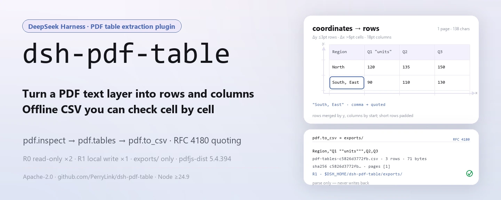
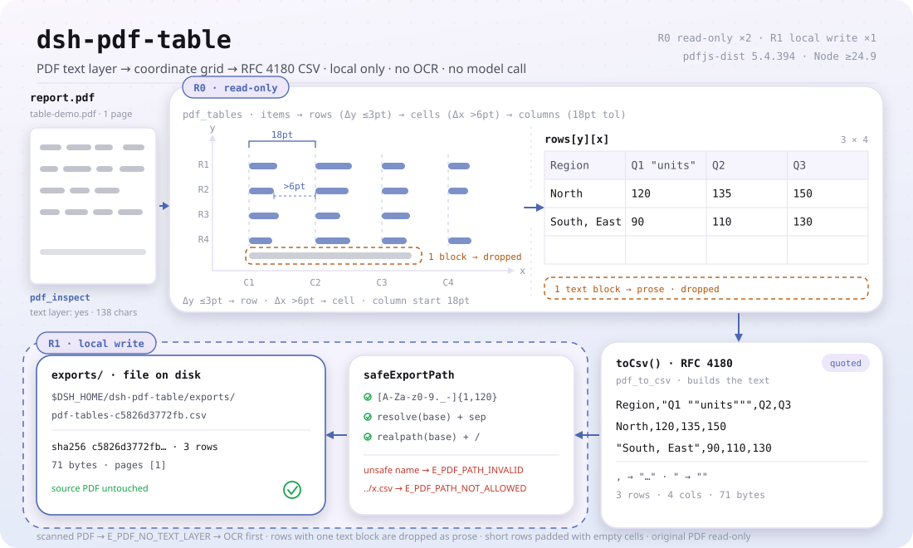

<div align="center">

<picture>
  <source media="(prefers-color-scheme: dark)" srcset="docs/assets/dsh-pdf-table-hero-en-dark.webp">
  
</picture>

# dsh-pdf-table

**टेक्स्ट-लेयर वाले PDF की तालिका को पंक्तियों और स्तंभों में बदलें, फिर ऐसा CSV निर्यात करें जिसे मिलान के लिए जाँचा जा सके।**

DeepSeek Harness के लिए पूरी तरह स्थानीय PDF तालिका निष्कर्षक: `pdf.inspect` टेक्स्ट-लेयर जाँचता है, `pdf.tables` निर्देशांकों से पंक्तियाँ और स्तंभ बनाता है, और `pdf.to_csv` कोट्स वाला CSV लिखता है — कोई नेटवर्क नहीं, कोई मॉडल कॉल नहीं, कोई अपलोड नहीं, और OCR भी नहीं।

[इंस्टॉल](#तीन-चरणों-में-शुरुआत) · [कॉन्फ़िगरेशन](#कॉन्फ़िगरेशन) · [FAQ](#faq) · [简体中文](README.md) · [English](README.en.md) · [Español](README.es.md) · [Português](README.pt.md) · [हिन्दी](README.hi.md)

[](LICENSE)
[](#संगतता)
[](https://www.npmjs.com/package/dsh-pdf-table)
[](https://github.com/PerryLink/dsh-pdf-table/actions/workflows/ci.yml)
[](#संगतता)

[](https://github.com/PerryLink/dsh-pdf-table/stargazers)
[](https://www.npmjs.com/package/dsh-pdf-table)

```sh
dsh plugin --profile <profile> add dsh-pdf-table
```

</div>

<sub>सामुदायिक प्लगइन, DeepSeek से असंबद्ध। कैनोनिकल रिपॉज़िटरी: <https://github.com/PerryLink/dsh-pdf-table> (कोई अन्य आधिकारिक मिरर नहीं)।</sub>

<sub>स्थिति: alpha / public-synthetic / partial / not counted / GA नहीं। कोई ग्राहक डेटा, ग्राहक प्रमाण या उत्पादन-तैयारी का दावा नहीं।</sub>

## यह क्या है

एक वाक्य में: यह स्थानीय PDF की **टेक्स्ट-लेयर** पढ़ता है, टेक्स्ट आइटम के निर्देशांकों से तालिका को फिर से पंक्तियों और स्तंभों में बनाता है, और RFC 4180 कोट-एस्केपिंग वाला CSV निर्यात करता है। यह OCR नहीं करता, लेआउट विश्लेषण नहीं करता, फ़ॉन्ट या बॉर्डर नहीं बनाता और आपके लिए राशि या इकाई की जाँच नहीं करता — यह केवल «एक पृष्ठ पर पंक्तियों-स्तंभों में रखे टेक्स्ट» को «ऐसे CSV» में बदलता है जिसे कोई दूसरा व्यक्ति जाँच सके।

<picture>
  <source media="(prefers-color-scheme: dark)" srcset="docs/assets/dsh-pdf-table-flow-v5-dark.svg">
  6pt के अंतर पर सेल बनते हैं और उनके आरंभ 18pt सहनशीलता पर C1-C4 स्तंभों में समूहित होते हैं; छोटी पंक्तियाँ खाली स्ट्रिंग से भरती हैं और एक-ब्लॉक पंक्ति गद्य मानकर छोड़ दी जाती है, जिससे 3x4 का rows[y][x] ग्रिड बनता है। toCsv() RFC 4180 कोट एस्केप लगाता है, टेक्स्ट R1 लेखन-सीमा पार करके safeExportPath (फ़ाइलनाम श्वेतसूची + realpath) से $DSH_HOME/dsh-pdf-table/exports/ तक जाता है और sha256 रसीद लौटाता है">
</picture>

- **उपयुक्त:** Word, Excel या रिपोर्ट जनरेटर से निकले वे PDF जिनमें वास्तविक टेक्स्ट-लेयर हो; प्रति पृष्ठ एक तालिका, या वे पृष्ठ जिनका स्तंभ ढाँचा एक जैसा हो; तालिका को CSV में ले जाकर मिलान, लोड या अभिलेखन करना।
- **अनुपयुक्त:** स्कैन, फ़ोटो और केवल-छवि वाले PDF (टेक्स्ट-लेयर नहीं); मर्ज किए गए सेल, पृष्ठों के पार जाने वाले सेल, घुमाए गए पृष्ठ, तालिकाओं के साथ मिली दो-स्तंभी गद्य; फ़ॉन्ट, रंग, बॉर्डर या सूत्रों का लेआउट पुनर्निर्माण; राशि या इकाई की मानवीय जाँच को बदलना।

```text
report.pdf ──pdf.inspect──▶ pages · chars_per_page · has_text_layer      (R0 केवल पढ़ना)
           ──pdf.tables──▶  rows[y][x]: y 3pt के भीतर = पंक्ति, x अंतर > 6pt = सेल  (R0 केवल पढ़ना)
           ──pdf.to_csv──▶  exports/*.csv + sha256 (RFC 4180 कोट एस्केप)   (R1 स्थानीय लेखन)
```

तीनों टूल मिलकर एक स्थानीय पाइपलाइन बनाते हैं: कोई OCR नहीं, कोई नेटवर्क अनुरोध नहीं, कोई मॉडल कॉल नहीं, और मूल PDF शुरू से अंत तक केवल पढ़ने के लिए रहता है।

## तीन चरणों में शुरुआत

1. **इंस्टॉल करें** (कोई एक चैनल चुनें):

   ```sh
   # npm चैनल (अनुशंसित, प्रकाशित संस्करण)
   dsh plugin --profile <profile> add dsh-pdf-table
   # git चैनल (नवीनतम main; git+https://github.com/PerryLink/dsh-pdf-table.git के बराबर)
   dsh plugin --profile <profile> add github:PerryLink/dsh-pdf-table
   # tarball चैनल: इस रेपो में pnpm pack के बाद
   dsh plugin --profile <profile> add ./dsh-pdf-table-<version>.tgz
   ```

   npm चैनल संकलित `lib/` के साथ आता है; git और tarball चैनल स्रोत लाते हैं, और इस पैकेज में `prepare` स्क्रिप्ट नहीं है, इसलिए `lib/` बनाने के लिए रेपो में `pnpm install && pnpm build` चलाना होगा (tarball पैक करने से पहले भी)।

2. **न्यूनतम कॉन्फ़िगरेशन** (कोई Config कुंजी नहीं है; एक माउंट की गई पंक्ति पर्याप्त है):

   ```yaml
   - insert:
       - id: dsh-pdf-table
         name: dsh-pdf-table
   ```

3. **कार्य करने की पुष्टि करें**:

   ```sh
   dsh --profile <profile> --dump-config | grep dsh-pdf-table
   node samples/quickstart/run.mjs --check
   ```

   दूसरा कमांड रेपो के अंदर चलता है; `quickstart ok` दिखे तो निष्कर्षण और CSV एस्केप दोनों ठीक हैं।

**अनइंस्टॉल**: `dsh plugin --profile <profile> remove dsh-pdf-table` (या प्रोफ़ाइल पैच से वह पंक्ति हटाएँ)।

## मुख्य क्षमताएँ

टूल के नाम स्थिर API हैं; विवरण अंग्रेज़ी में रखे गए हैं ताकि रनटाइम आउटपुट से मेल खाएँ।

| टूल | उपयोग | जोखिम |
|---|---|---|
| `pdf.inspect` | पृष्ठ संख्या, प्रति पृष्ठ टेक्स्ट अक्षर और टेक्स्ट-लेयर की उपस्थिति; लेयर न हो तो `E_PDF_NO_TEXT_LAYER` | R0 |
| `pdf.tables` | आइटम को y से पंक्तियों में और x अंतराल से स्तंभों में समूहित करता है; प्रति पृष्ठ `{ page, rows }` लौटाता है | R0 |
| `pdf.to_csv` | कोट-एस्केप वाला CSV लिखता है और पथ + sha256 लौटाता है | R1 स्थानीय लेखन |

- **टेक्स्ट-लेयर निर्देशांक समूहन** — एक ही y (≤3pt) पर आइटम एक पंक्ति बनाते हैं, 6pt से बड़ा x अंतराल नया सेल खोलता है, और सेल के आरंभ 18pt सहनशीलता से स्तंभों में समूहित होते हैं; एक ही टेक्स्ट ब्लॉक वाली पंक्तियाँ गद्य मानी जाकर छोड़ दी जाती हैं।
- **दो जोखिम स्तर** — `pdf.inspect` और `pdf.tables` R0 (केवल पढ़ना) हैं; `pdf.to_csv` R1 (स्थानीय लेखन) है और हमेशा `$DSH_HOME/dsh-pdf-table/exports/` के नीचे लिखता है।
- **नियंत्रित निर्यात पथ** — फ़ाइल नाम `[A-Za-z0-9._-]{1,120}` से मेल खाना चाहिए; `../`, पथ विभाजक और सिम्लिंक से बाहर निकलना अस्वीकार होता है (`E_PDF_PATH_INVALID` / `E_PDF_PATH_NOT_ALLOWED`)।
- **CSV कोट एस्केप** — अल्पविराम, दोहरा उद्धरण, CR या LF वाले फ़ील्ड कोट में लपेटे जाते हैं और अंदर के उद्धरण दोहराए जाते हैं (RFC 4180)।
- **sha256 रसीद** — `pdf.to_csv` पथ, `sha256`, पंक्ति संख्या, बाइट और वास्तव में निर्यात किए गए पृष्ठ लौटाता है, ताकि हर मद जाँची जा सके।
- **त्रुटि के साथ अगला कदम** — नौ स्थिर `E_PDF_*` कोड, प्रारूप `<एक मानव वाक्य>（E_PDF_XXX）`; देखें «त्रुटि कोड»।

### `pdf.tables` की पंक्ति/स्तंभ नियम

1. केवल-रिक्त आइटम हटाए जाते हैं और y के अनुसार अवरोही क्रम में लगाए जाते हैं; 3pt के भीतर के आइटम एक ही पंक्ति में आते हैं।
2. हर पंक्ति को x से क्रमबद्ध किया जाता है; 6pt से बड़ा अंतराल नया सेल खोलता है, छोटे अंतराल मिला दिए जाते हैं।
3. पूरे पृष्ठ के सेल आरंभ 18pt सहनशीलता से स्तंभों में समूहित होते हैं; छोटी पंक्तियाँ भरी जाती हैं।
4. एक ही टेक्स्ट ब्लॉक वाली पंक्तियाँ गद्य हैं और छोड़ दी जाती हैं।

यह टेक्स्ट-लेयर अनुमान है, लेआउट विश्लेषण इंजन नहीं; सीमाएँ नीचे हैं। *Observed from `src/core/pdf.ts:274-276`*

## इनपुट

- स्थानीय `.pdf` का पथ। फ़ाइल में टेक्स्ट-लेयर होना चाहिए; संदेह हो तो पहले `pdf.inspect` चलाएँ।
- लगभग 50 MB तक का एक फ़ाइल उचित स्थानीय सीमा है (यह सुझाव है, कोड में कोई कठोर थ्रेशोल्ड नहीं)। `pages` 1-आधारित पृष्ठ चुनता है।
- PDF केवल पढ़ने के लिए है और कभी बदला नहीं जाता।
- **स्कैन किए गए PDF समर्थित नहीं हैं**: टेक्स्ट-लेयर न होने पर `E_PDF_NO_TEXT_LAYER` आता है और OCR के लिए कहता है।

## आउटपुट

- `pdf.inspect`: `{ pages, chars_per_page, total_chars, has_text_layer, pages_without_text }`.
- `pdf.tables`: `{ tables: [{ page, rows: string[][] }], rows }`; एक ही y के आइटम पंक्ति बनाते हैं, x अंतराल स्तंभ तय करते हैं और सेल का टेक्स्ट ट्रिम होता है।
- `pdf.to_csv`: `{ path, sha256, rows, bytes, pages }`. फ़ाइल `$DSH_HOME/dsh-pdf-table/exports/` में जाती है, डिफ़ॉल्ट नाम `pdf-tables-<sha256 के पहले 12 अक्षर>.csv`; मूल PDF अछूता रहता है।

## उदाहरण

यह पंक्ति एजेंट में पेस्ट करें:

```text
把这个 PDF 里的表格提取成 CSV，保留原来的行列结构。
```

साथ दिए गए नमूने को दोबारा चलाएँ और गोल्डन फ़ाइल से मिलाएँ:

```sh
node samples/quickstart/run.mjs --check
```

वास्तविक आउटपुट (स्क्रीनशॉट: [`docs/assets/quickstart.png`](docs/assets/quickstart.png); लॉग: [`docs/assets/quickstart.log`](docs/assets/quickstart.log)):

```text
dsh-pdf-table quickstart - synthetic text-layer PDF (no OCR, not customer data)
1 page, 138 text chars; text layer yes
table: 3 rows x 4 columns on page 1
header: Region | Q1 "units" | Q2 | Q3
row: North | 120 | 135 | 150
row: South, East | 90 | 110 | 130
CSV exports/table-demo.csv: 3 rows, 71 bytes, sha256 c5826d3772fb...
CSV escaping: comma -> "South, East"; quote -> "Q1 ""units"""
golden samples/quickstart/expected/result.json matches
quickstart ok
```


निर्यात किया गया CSV ठीक गोल्डन फ़ाइल `samples/quickstart/expected/result.json` का `csv.text` फ़ील्ड है:

```csv
Region,"Q1 ""units""",Q2,Q3
North,120,135,150
"South, East",90,110,130
```

नमूना PDF कोड से बना न्यूनतम कृत्रिम फ़ाइल है: 3 पंक्तियाँ × 4 स्तंभ वाली तालिका और एक गद्य पंक्ति। हेडर `Q1 "units"` और सेल `South, East` में जानबूझकर उद्धरण और अल्पविराम रखे गए हैं ताकि CSV के दोनों कोट नियम जाँचे जाएँ; गद्य पंक्ति «एक टेक्स्ट ब्लॉक = गद्य» नियम से हट जाती है। गोल्डन फ़ाइल `node samples/quickstart/run.mjs --json` का वास्तविक स्टडआउट है, हाथ से लिखी नहीं।

टूल सतह के कॉल:

```sh
# 1) पृष्ठ संख्या और टेक्स्ट-लेयर
#    सतह: pdf.inspect({ path: "/abs/path/report.pdf" })

# 2) तालिका की पंक्तियाँ निकालें
#    सतह: pdf.tables({ path: "/abs/path/report.pdf", pages: [1] })

# 3) CSV निर्यात करें
#    सतह: pdf.to_csv({ path: "/abs/path/report.pdf", filename: "report.csv" })
```

## कॉन्फ़िगरेशन

इस प्लगइन में **कोई Config कुंजी नहीं है** — माउंट के बाद सब कुछ उपलब्ध है और बदलने योग्य केवल प्रोफ़ाइल पैच की वह एक पंक्ति है। सारे समायोजन तीनों टूल के आर्ग्युमेंट पर हैं:

| टूल | आर्ग्युमेंट | आवश्यक | अर्थ |
|---|---|---|---|
| `pdf.inspect` | `path` | हाँ | जाँचने वाले PDF का पूर्ण पथ |
| `pdf.tables` | `path` | हाँ | निकालने वाले PDF का पूर्ण पथ |
| `pdf.tables` | `pages` | नहीं | 1-आधारित पृष्ठ सूची; न दें = सभी पृष्ठ; खाली सूची या सीमा से बाहर पृष्ठ पर `E_PDF_PAGE_RANGE` |
| `pdf.to_csv` | `path` | हाँ | निर्यात करने वाले PDF का पूर्ण पथ |
| `pdf.to_csv` | `pages` | नहीं | ऊपर जैसा |
| `pdf.to_csv` | `filename` | नहीं | निर्यात फ़ाइल नाम, केवल `[A-Za-z0-9._-]{1,120}`; डिफ़ॉल्ट `pdf-tables-<sha256 के पहले 12 अक्षर>.csv` |

स्थानीय लेखन रूट: `$DSH_HOME/dsh-pdf-table` (निर्यात उसके `exports/` में)। परीक्षण में `DSH_PDF_TABLE_HOME` से बदला जा सकता है; `DSH_HOME` सेट न हो तो प्लगइन वर्तमान कार्य निर्देशिका (`process.cwd()/dsh-pdf-table`) पर लौटता है — *Observed from `src/plugin/index.ts:9-14`*।

## FAQ

<details>
<summary>क्या स्कैन किया गया PDF पढ़ा जा सकता है?</summary>

नहीं। यह पैकेज टेक्स्ट-लेयर पढ़ता है और **OCR नहीं करता**। केवल-छवि वाला PDF `E_PDF_NO_TEXT_LAYER` के साथ विफल होता है; पहले OCR कराकर टेक्स्ट वाला PDF बनाएँ, फिर `pdf.inspect` चलाकर `total_chars > 0` की पुष्टि करें।

</details>

<details>
<summary>कोई स्तंभ मिल क्यों जाता है या बँट क्यों जाता है?</summary>

पहले `node samples/quickstart/run.mjs --check` चलाकर वातावरण की समस्या हटाएँ। स्तंभ आइटमों के बीच x अंतराल से बनते हैं: संकरे अंतराल, एक सेल में कई टेक्स्ट आइटम, या एक ही पृष्ठ पर अलग ढाँचे वाली दो तालिकाएँ स्तंभ मिला या बाँट सकती हैं। `pdf.tables` की `rows` देखें और ज़रूरत हो तो `pages` से एक-एक पृष्ठ निर्यात करें।

</details>

<details>
<summary>सेल में अल्पविराम और उद्धरण सुरक्षित हैं?</summary>

हाँ। अल्पविराम, दोहरा उद्धरण, CR या LF वाले फ़ील्ड कोट में लपेटे जाते हैं और अंदर के उद्धरण दोहराए जाते हैं (RFC 4180)। नमूना `South, East` और `Q1 "units"` दोनों को कवर करता है। ध्यान दें: यह पैकेज केवल कोट एस्केप करता है, Excel सूत्र उपसर्ग साफ़ नहीं करता।

</details>

<details>
<summary>क्या यह मेरा PDF बदलता है या अपलोड करता है?</summary>

नहीं। यह बताई गई PDF पढ़ता है, केवल `$DSH_HOME/dsh-pdf-table/exports/` के नीचे लिखता है, और कभी नेटवर्क या मॉडल कॉल नहीं करता। मूल PDF का sha256 केवल डिफ़ॉल्ट फ़ाइल नाम बनाने में लगता है; फ़ाइल में कुछ भी वापस नहीं लिखा जाता।

</details>

<details>
<summary>प्रदर्शन पर कितना खर्च आता है?</summary>

हर कॉल PDF को मेमोरी में पढ़ती है और स्थानीय pdfjs-dist से टेक्स्ट-लेयर पार्स करती है, कोई कैश नहीं, इसलिए खर्च पृष्ठों और आइटमों की संख्या के साथ बढ़ता है। कोई नेटवर्क अनुरोध, मॉडल कॉल या पृष्ठभूमि प्रक्रिया नहीं है, इसलिए निष्क्रिय खर्च शून्य है। रेपो कोई समय-आधारित बेंचमार्क प्रकाशित नहीं करता और 50 MB को कठोर सीमा न मानें: मेमोरी कम हो तो फ़ाइल बाँटें या `pages` इस्तेमाल करें।

</details>

## सुरक्षा सीमाएँ

- **मूल PDF केवल पढ़ने के लिए।** `openPdf` केवल बाइट्स पढ़ता है और `sha256` निकालता है; सफल या विफल किसी भी रास्ते में स्रोत फ़ाइल पर वापस नहीं लिखा जाता।
- **लेखन की एक ही सतह।** `pdf.to_csv` हमेशा `$DSH_HOME/dsh-pdf-table/exports/` में लिखता है; फ़ाइल नाम श्वेतसूची से गुज़रता है और हल किया गया पथ `realpath` से दोबारा जाँचा जाता है, इसलिए सिम्लिंक लेखन को निर्यात निर्देशिका से बाहर नहीं ले जा सकता।
- **कोई नेटवर्क नहीं, कोई मॉडल नहीं।** पार्सिंग प्रक्रिया के अंदर होती है (pdfjs-dist `5.4.394`): कोई fetch नहीं, कोई बाहरी सेवा नहीं, कोई मॉडल कॉल नहीं।
- **विफलता पर बंद।** टेक्स्ट-लेयर न होना, भ्रष्ट फ़ाइल, खाली फ़ाइल, एन्क्रिप्शन, सीमा से बाहर पृष्ठ और लेखन विफलता स्थिर त्रुटि कोड और अगला कदम देती हैं, चुपचाप खाली तालिका नहीं लौटातीं।
- **रजिस्ट्रेशन एक इफ़ेक्ट है।** तीनों टूल `apply()` में पंजीकृत होते हैं और रोकने या हॉट रीलोड पर हट जाते हैं।

## अनुमतियाँ और डेटा

पढ़ना: उपयोगकर्ता द्वारा बताई गई PDF (नमूना `samples/quickstart/input/table-demo.pdf`); इसके अलावा कुछ नहीं।
लिखना: केवल `$DSH_HOME/dsh-pdf-table/exports/` (CSV आउटपुट); मूल PDF नहीं बदलता।
नेटवर्क: नहीं।
बाहरी सिस्टम: कोई नहीं।

`pdf.inspect` और `pdf.tables` **R0** (केवल पढ़ना) हैं; `pdf.to_csv` **R1** (स्थानीय लेखन, केवल `$DSH_HOME/dsh-pdf-table/exports/` के नीचे) है। परीक्षण में `DSH_PDF_TABLE_HOME` स्थानीय लेखन रूट बदल सकता है; डिफ़ॉल्ट ठीक `$DSH_HOME/dsh-pdf-table` है।

## त्रुटि कोड

| कोड | कब आता है | अगला कदम |
|---|---|---|
| `E_PDF_PATH_INVALID` | खाली पथ, निर्देशिका, अपठनीय पथ, या असुरक्षित निर्यात नाम | मौजूद `.pdf` का पूर्ण पथ दें; निर्यात में केवल `[A-Za-z0-9._-]` नाम दें |
| `E_PDF_NOT_FOUND` | फ़ाइल मौजूद नहीं है | पथ की वर्तनी और केस जाँचें |
| `E_PDF_EMPTY` | 0 बाइट फ़ाइल, या शून्य पृष्ठ वाली PDF | खाली न हो और बिना भ्रष्ट PDF लें |
| `E_PDF_CORRUPT` | कटी-फटी या अधूरी फ़ाइल, या `.pdf` जो वास्तव में PDF नहीं है | रीडर में खोलकर नई प्रति "Save as" करें, फिर दोबारा चलाएँ |
| `E_PDF_ENCRYPTED` | पासवर्ड से सुरक्षित, टेक्स्ट-लेयर पढ़ा नहीं जा सकता | मालिक पासवर्ड से बिना पासवर्ड प्रति निर्यात करें (यह पैकेज पासवर्ड का अनुमान नहीं लगाता) |
| `E_PDF_NO_TEXT_LAYER` | स्कैन या केवल-छवि PDF, कोई निकालने योग्य अक्षर नहीं | पहले OCR कराकर टेक्स्ट वाली PDF बनाएँ, फिर दोबारा चलाएँ |
| `E_PDF_PAGE_RANGE` | `pages` खाली, धनात्मक पूर्णांक नहीं, सीमा से बाहर या अमान्य पृष्ठ | 1 से शुरू करें और `pdf.inspect` के `pages` का उपयोग करें |
| `E_PDF_PATH_NOT_ALLOWED` | निर्यात पथ `exports/` से बाहर जाता है (realpath के बाद भी) | केवल फ़ाइल नाम दें, `../`, पथ विभाजक या सिम्लिंक नहीं |
| `E_PDF_EXPORT_FAILED` | स्थानीय लेखन विफल: निर्देशिका लिखने योग्य नहीं, डिस्क भरी आदि | `$DSH_HOME/dsh-pdf-table` के लिखने योग्य होने की पुष्टि करें और दोबारा चलाएँ |

हर संदेश का आकार: `<एक मानव वाक्य>（E_PDF_XXX）`। कोड-वार समाधान: [TROUBLESHOOTING.md](TROUBLESHOOTING.md)।

## स्वीकृति प्रमाण

सार्वजनिक/कृत्रिम फ़िक्स्चर `samples/quickstart/` में हैं; `ACCEPTANCE.csv` जाँच दर्ज करता है। quickstart पंक्ति के अलावा हर पंक्ति `counted=false` है।

| req_id | metric | threshold | actual | pass | source | counted |
|---|---|---|---|---|---|---|
| PDF-A01 | inspect pages/chars | pages=1 chars>0 | pages=1 chars=129 | true | public/synthetic | false |
| PDF-A02 | table 3x4 | 3 rows x 4 cols | 3 rows x 4 cols | true | public/synthetic | false |
| PDF-A03 | page filter | page 2 only | pages=2 | true | public/synthetic | false |
| PDF-A04 | CSV quoting | comma+quote escaped | escaped | true | public/synthetic | false |
| PDF-A05 | CSV sha256 | matches file | c5826d3772fb | true | public/synthetic | false |
| PDF-A06 | scanned PDF error | E_PDF_NO_TEXT_LAYER | E_PDF_NO_TEXT_LAYER | true | public/synthetic | false |
| PDF-A07 | corrupt PDF error | E_PDF_CORRUPT | E_PDF_CORRUPT | true | public/synthetic | false |
| PDF-A08 | empty PDF error | E_PDF_EMPTY | E_PDF_EMPTY | true | public/synthetic | false |
| PDF-A09 | export path safety | traversal rejected | E_PDF_PATH_INVALID | true | public/synthetic | false |
| PS1-QS01 | quickstart golden | 1/1 | 1 | true | synthetic/quickstart | true |

*ये फ़िक्स्चर-आधारित पंक्तियाँ हैं, ग्राहक रन नहीं; कोई आउटपुट नहीं गढ़ा गया।*

## ज्ञात सीमाएँ

- **OCR नहीं:** केवल-छवि PDF को पहले OCR कराना होगा।
- केवल निर्देशांक समूहन: मर्ज किए गए सेल, पृष्ठों के पार सेल, घुमाए गए पृष्ठ, लंबवत टेक्स्ट और बहु-स्तंभी गद्य गलत पढ़े जा सकते हैं।
- प्रति पृष्ठ एक स्तंभ समुच्चय: एक ही पृष्ठ पर अलग आकार की दो तालिकाएँ एक समुच्चय में मिल सकती हैं।
- संख्या/इकाई/सूत्र की जाँच नहीं; फ़ॉन्ट, रंग और बॉर्डर नहीं बनाए जाते।
- CSV केवल RFC 4180 कोट एस्केप करता है; Excel सूत्र उपसर्ग साफ़ नहीं होते।
- केवल स्थानीय: कोई नेटवर्क नहीं, कोई मॉडल कॉल नहीं, कोई अपलोड नहीं।
- केवल सार्वजनिक/कृत्रिम नमूने; alpha/partial, not counted, GA या उत्पादन-तैयारी का दावा नहीं।

## इंटरऑपरेबिलिटी

- **केवल `tools` सेवा पर निर्भर** (`inject = ['tools']`): प्रोफ़ाइल tools को compose करे तभी प्लगइन लोड होता है, और यह कोई सेवा कुंजी नहीं देता, इसलिए सेवा-कुंजी टकराव असंभव है।
- **टूल नामों पर `pdf.` उपसर्ग**: कोई बेयर अंतर्निहित नाम नहीं लिया जाता। यदि कोई दूसरा प्लगइन भी `pdf.*` टूल पंजीकृत करता है तो वह वास्तविक नाम टकराव है — इंस्टॉल से पहले `dsh --profile <profile> --dump-config` से टूल सतह देखें।
- **कोई ब्राउज़र आधा नहीं**: मैनिफ़ेस्ट `dsh.client` नहीं घोषित करता (`scripts/lint.mjs` में `!pkg.dsh?.client` जाँच), इसलिए कोई क्लाइंट स्लॉट पंजीकृत नहीं होता और UI सीट की होड़ नहीं होती।
- **कोई HTTP रूट नहीं**: कोई `webServer` उपसर्ग पंजीकृत नहीं और कोई पोर्ट नहीं सुना जाता।
- **पैच केवल स्वयं को जोड़ता है**: `cordis.patch.yml` में एक ही `insert` पंक्ति है; यह अंतर्निहित पंक्तियों को नहीं ढकता और ग्लोबल ऑब्जेक्ट नहीं बदलता।

## संगतता

| आयाम | स्थिति |
|---|---|
| Harness | `dsh >=0.2.1-rc.3 <0.4.0` |
| Node | `>=24.9.0 <25` |
| प्लेटफ़ॉर्म | सभी; केवल स्थानीय फ़ाइलें |
| डेटा | कोई नेटवर्क नहीं, कोई मॉडल कॉल नहीं, कोई अपलोड नहीं |

## इकोसिस्टम और गुणवत्ता

- [डोमेन इंडेक्स](https://perrylink.github.io/dsh-plugins/) (परिवार का अवलोकन, कार्य-आधारित ब्राउज़िंग और पैकेज संस्करण)
- [npm पैकेज पृष्ठ](https://www.npmjs.com/package/dsh-pdf-table) (संस्करण, डाउनलोड और निर्भरता)
- [GitHub रिपॉज़िटरी](https://github.com/PerryLink/dsh-pdf-table) (issues, Actions और रिलीज़)
- रनटाइम निर्भरता [pdfjs-dist](https://www.npmjs.com/package/pdfjs-dist) `5.4.394` (केवल स्थानीय टेक्स्ट-लेयर पार्सिंग, कोई नेटवर्क अनुरोध नहीं)

## संबंधित कार्य

- [dsh-ghg](https://github.com/PerryLink/dsh-ghg) (यह भी pdfjs-dist से PDF टेक्स्ट पढ़ता है)
- [dsh-pim-lint](https://github.com/PerryLink/dsh-pim-lint) (CSV सत्यापन टूल)

## डेवलपमेंट

```sh
pnpm install --frozen-lockfile
pnpm build && pnpm lint && pnpm typecheck
node --test test/*.test.mjs
node scripts/gate.mjs
```

वर्तमान संस्करण `0.1.0`, 31 परीक्षण पास (`node --test test/*.test.mjs`)। रिलीज़ गेट: `node scripts/gate.mjs` (मेटाडेटा lint + सभी सार्वजनिक स्वीकृति पंक्तियाँ)।

| पथ | सामग्री |
|---|---|
| `src/core/pdf.ts` | pdfjs लोडिंग, टेक्स्ट आइटम, पंक्ति/स्तंभ समूहन और नौ स्थिर कोड |
| `src/core/csv.ts` | RFC 4180 फ़ील्ड एस्केप और CSV संयोजन |
| `src/core/safe-path.ts` | निर्यात फ़ाइल नाम श्वेतसूची और निर्देशिका-पलायन जाँच |
| `src/plugin/index.ts` | `resolveBaseDir` (`DSH_PDF_TABLE_HOME` / `DSH_HOME`) और `apply` |
| `src/plugin/tools.ts` | `pdf.inspect` / `pdf.tables` / `pdf.to_csv` टूल सतह |
| `test/*.test.mjs` | 31 `node --test` केस (CSV, PDF, पथ, प्लगइन स्मोक, quickstart) |
| `samples/quickstart/` | कृत्रिम PDF, गोल्डन `expected/result.json` और दोबारा चलाने की स्क्रिप्ट |
| `docs/assets/` | आरेख और वास्तविक टर्मिनल आउटपुट (`quickstart.png` / `quickstart.log`) |

शुरुआती हीरो और «यह क्या है» वाला संरचना-चित्र दोनों [`scripts/gen-readme-assets.py`](scripts/gen-readme-assets.py) से बनते हैं: हीरो Pillow से `docs/assets/dsh-pdf-table-hero-{zh,en}-{light,dark}.webp` (1440×576) में बनता है, और संरचना-चित्र हाथ से लिखे SVG के रूप में `docs/assets/dsh-pdf-table-flow-v5-{light,dark}.svg` (1100×660, केवल कमांड टोकन, पाँचों भाषाओं के लिए साझा) में। दोबारा चलाने के लिए: `python scripts/gen-readme-assets.py` (फ़ॉन्ट न मिले या कोई लेबल अपने बॉक्स में न बैठे तो यह रुक जाता है)। `docs/assets/quickstart.png` वास्तविक रन का स्क्रीनशॉट है और `docs/assets/quickstart.log` के साथ रखा जाता है; पुराना `docs/assets/dsh-pdf-table-flow.svg` और उसका हल्का/गहरा जोड़ा इसलिए रखे गए हैं कि पुराने लिंक 404 न हों, जबकि README अब हीरो और flow-v5 इस्तेमाल करता है।

Topics: `dsh`, `dsh-plugin`, `deepseek-harness`, `deepseek`, `pdf`, `table`, `csv`, `pdfjs`, `perrylink`

## परिवार और आभार

यह परियोजना [PerryLink](https://github.com/PerryLink) द्वारा अनुरक्षित DeepSeek Harness प्लगइन परिवार की सदस्य है (सभी Apache-2.0)। अगर यह प्लगइन आपके काम आए तो **एक स्टार दें** — इससे कोई सुविधा नहीं खुलती, पर अगला व्यक्ति इसे जल्दी खोज लेता है।

- [@PerryLink](https://github.com/PerryLink) — निर्माता और अनुरक्षक: टेक्स्ट-लेयर निर्देशांक समूहन, तीन टूल सतह, quickstart गोल्डन नमूना और पाँच-भाषा दस्तावेज़।

## लाइसेंस

[LICENSE](LICENSE) (Apache License 2.0) © 2026 dsh-pdf-table contributors. `NOTICE` और `THIRD-PARTY-NOTICES` भी देखें।

<p align="center"><sub>Apache-2.0 · सामुदायिक प्लगइन, DeepSeek से असंबद्ध।</sub></p>
