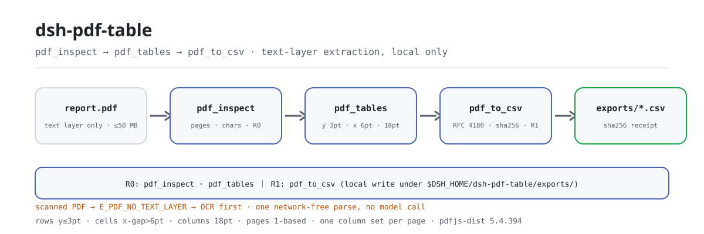

<div align="center">

<picture>
  <source media="(prefers-color-scheme: dark)" srcset="docs/assets/dsh-pdf-table-flow-dark.svg">
  
</picture>

# dsh-pdf-table

**把带文本层的 PDF 里的表格还原成行列，导出成能直接核对的 CSV。**

面向 DeepSeek Harness 的纯本地 PDF 表格抽取工具：`pdf.inspect` 看有没有文本层，`pdf.tables` 按坐标还原行列，`pdf.to_csv` 落成带引号转义的 CSV——不联网、不调用模型、不上传；扫描件不做 OCR。

[安装](#三步上手) · [配置](#配置) · [FAQ](#faq) · [简体中文](README.md) · [English](README.en.md) · [Español](README.es.md) · [Português](README.pt.md) · [हिन्दी](README.hi.md)

[](LICENSE)
[](#兼容性)
[](https://www.npmjs.com/package/dsh-pdf-table)
[](https://github.com/PerryLink/dsh-pdf-table/actions/workflows/ci.yml)
[](#兼容性)

[](https://github.com/PerryLink/dsh-pdf-table/stargazers)
[](https://www.npmjs.com/package/dsh-pdf-table)

```sh
dsh plugin --profile <profile> add dsh-pdf-table
```

</div>

<sub>社区插件，与 DeepSeek 官方无关。唯一仓库：<https://github.com/PerryLink/dsh-pdf-table>（没有其他官方镜像）。</sub>

<sub>状态：alpha / 公开合成 / partial / not counted / 非 GA——不含客户数据、客户证据，也不作生产可用声明。</sub>

## 它是什么

一句话：读本地 PDF 的**文本层**，按文本项坐标把表格还原成行和列，再导出成 RFC 4180 带引号转义的 CSV。它不做 OCR、不做版面分析、不还原字体颜色边框，也不会替你核对金额和单位——它只负责把「同一页上按行列排布的文字」变成「一张能被别人复核的 CSV」。

- **适合**：由 Word / Excel / 报表工具导出的、带真实文本层的 PDF；一页一张表，或各页列结构一致的表；需要把表格落到 CSV 再做核对、入库或留档的场景。
- **不适合**：扫描件、拍照件、纯图片 PDF（没有文本层）；合并单元格、跨页跨行单元格、旋转页面、双栏/多栏正文混排；需要还原字体、颜色、边框或公式的版式分析；替代人工核对金额/单位。

```text
report.pdf ──pdf.inspect──▶ pages · chars_per_page · has_text_layer      （R0 只读）
           ──pdf.tables──▶  rows[y][x]：y 差 ≤3pt 成行，x 间隔 >6pt 分格   （R0 只读）
           ──pdf.to_csv──▶  exports/*.csv + sha256（RFC 4180 引号转义）    （R1 本地写）
```

三个工具构成一条本地流水线：没有 OCR、没有网络请求、没有模型调用，原 PDF 全程只读。

## 三步上手

1. **安装**（三选一）：

   ```sh
   # npm 通道（推荐，已发布版本）
   dsh plugin --profile <profile> add dsh-pdf-table
   # git 通道（最新 main；等价于 git+https://github.com/PerryLink/dsh-pdf-table.git）
   dsh plugin --profile <profile> add github:PerryLink/dsh-pdf-table
   # tarball 通道：本仓库 pnpm pack 后
   dsh plugin --profile <profile> add ./dsh-pdf-table-<version>.tgz
   ```

   npm 通道带编译产物 `lib/`；git 与 tarball 通道拿到的是源码，本包没有 `prepare` 脚本，需先在仓库内 `pnpm install && pnpm build` 生成 `lib/`（打 tarball 前同样要先 build）。

2. **最小配置**（没有任何 Config 键，挂载一行即可）：

   ```yaml
   - insert:
       - id: dsh-pdf-table
         name: dsh-pdf-table
   ```

3. **验证已生效**：

   ```sh
   dsh --profile <profile> --dump-config | grep dsh-pdf-table
   node samples/quickstart/run.mjs --check
   ```

   第二条命令在仓库内运行，输出 `quickstart ok` 即表示提取与 CSV 转义都正常。

**卸载**：`dsh plugin --profile <profile> remove dsh-pdf-table`（或从 profile patch 删掉该行）。

## 核心能力

工具名是稳定 API；工具说明保留英文以匹配运行时输出。

| 工具 | 用途 | 风险 |
|---|---|---|
| `pdf.inspect` | 页数、每页文本字符数、是否有文本层；无文本层报 `E_PDF_NO_TEXT_LAYER` | R0 |
| `pdf.tables` | 按 y 行聚类 + x 列间隔聚类提取表格，返回每页 `{ page, rows }` | R0 |
| `pdf.to_csv` | 把提取结果写成带引号转义的 CSV，返回路径与 sha256 | R1 本地写 |

- **文本层坐标聚类** —— 同一 y（≤3pt）的文本项成行，行内 x 间隔 >6pt 分格，全页列起点按 18pt 容差聚类；只有 1 个文本块的行按正文跳过。
- **两档风险面** —— `pdf.inspect` / `pdf.tables` 是 R0 只读；`pdf.to_csv` 是 R1 本地写，固定落在 `$DSH_HOME/dsh-pdf-table/exports/`。
- **导出路径受控** —— 文件名只允许 `[A-Za-z0-9._-]{1,120}`，`../`、目录分隔符与软链逃逸都会被拒（`E_PDF_PATH_INVALID` / `E_PDF_PATH_NOT_ALLOWED`）。
- **CSV 引号转义** —— 逗号、双引号、CR/LF 自动整体加引号，内部引号双写（RFC 4180）。
- **sha256 回执** —— `pdf.to_csv` 返回路径、`sha256`、行数、字节数与实际导出的页码，方便逐项核对。
- **报错带下一步** —— 9 个稳定 `E_PDF_*` 错误码，统一格式 `<一句人话>（E_PDF_XXX）｜下一步：<一个动作>`，见「错误码」。

### `pdf.tables` 的行列规则

1. 过滤空白文本项后，按 y 从大到小排序；y 差 ≤ 3pt 视为同一行。
2. 行内按 x 排序；相邻文本项 x 间隔 > 6pt 视为新单元格，否则合并。
3. 全页单元格的 x 起点按 18pt 容差聚类成列；短行用空字符串补齐。
4. 只有 1 个文本块的行视为正文，不当作表格行。

这是文本层启发式，不是版面分析引擎；边界见「已知限制」。阈值常量出处：*Observed from `src/core/pdf.ts:274-276`*

## 输入

- 格式：本地 `.pdf` 文件路径，文件必须带文本层（可用 `pdf.inspect` 先检查）。
- 大小：建议单文件 ≤ 50 MB（这是建议值，不是代码里的硬阈值）；页数不限，`pages` 可按 1-based 页码只选需要的页。
- 来源：用户自己指定的 PDF；原文件只读，不会被修改。
- **不支持扫描件**：没有文本层的 PDF 会返回 `E_PDF_NO_TEXT_LAYER`，提示「这是扫描件，请先 OCR」。

## 输出

- `pdf.inspect`：`{ pages, chars_per_page, total_chars, has_text_layer, pages_without_text }`。
- `pdf.tables`：`{ tables: [{ page, rows: string[][] }], rows }`；同一 y 的文本项成行，x 间隔聚类成列，单元格首尾空白会被清理。
- `pdf.to_csv`：`{ path, sha256, rows, bytes, pages }`；文件写到 `$DSH_HOME/dsh-pdf-table/exports/`，默认文件名 `pdf-tables-<sha256 前 12 位>.csv`，原 PDF 不改。

## 示例

直接复制下面这句发给 agent：

> 把这个 PDF 里的表格提取成 CSV，保留原来的行列结构。

用自带样例复跑并核对金标：

```sh
node samples/quickstart/run.mjs --check
```

真实输出（截图见 [`docs/assets/quickstart.png`](docs/assets/quickstart.png)，原始日志见 [`docs/assets/quickstart.log`](docs/assets/quickstart.log)）：

```text
dsh-pdf-table quickstart - synthetic text-layer PDF (no OCR, not customer data)
1 page, 138 text chars; text layer yes
table: 3 rows x 4 columns on page 1
header: Region | Q1 "units" | Q2 | Q3
row: North | 120 | 135 | 150
row: South, East | 90 | 110 | 130
CSV exports/table-demo.csv: 3 rows, 71 bytes, sha256 c5826d3772fb...
CSV escaping: comma -> "South, East"; quote -> "Q1 ""units"""
golden samples/quickstart/expected/result.json matches
quickstart ok
```


导出的 CSV 就是上面这份金标里的文本（`samples/quickstart/expected/result.json` 的 `csv.text` 字段）：

```csv
Region,"Q1 ""units""",Q2,Q3
North,120,135,150
"South, East",90,110,130
```

样例 PDF 是代码生成的最小合成文件：3 行 × 4 列 + 一段说明文字。表头 `Q1 "units"` 和数据 `South, East` 故意包含引号与逗号，用来同时验证 CSV 的两种转义；那段说明文字会被「只有 1 个文本块的行按正文跳过」的规则丢掉。金标由 `node samples/quickstart/run.mjs --json` 真实产生，不是手写。

调用示例（工具面）：

```sh
# 1) 看页数与文本层
#    工具面：pdf.inspect({ path: "/abs/path/report.pdf" })

# 2) 提取表格
#    工具面：pdf.tables({ path: "/abs/path/report.pdf", pages: [1] })

# 3) 导出 CSV
#    工具面：pdf.to_csv({ path: "/abs/path/report.pdf", filename: "report.csv" })
```

## 配置

本插件**没有 Config 键**——挂载后即全部可用，唯一能改的是 profile patch 里的那一行；所有可调项都在三个工具的调用参数上：

| 工具 | 参数 | 必填 | 含义 |
|---|---|---|---|
| `pdf.inspect` | `path` | 是 | 待检查 PDF 的绝对路径 |
| `pdf.tables` | `path` | 是 | 待提取 PDF 的绝对路径 |
| `pdf.tables` | `pages` | 否 | 1-based 页码数组；不传 = 全部页，传空数组或越界页码报 `E_PDF_PAGE_RANGE` |
| `pdf.to_csv` | `path` | 是 | 待导出 PDF 的绝对路径 |
| `pdf.to_csv` | `pages` | 否 | 同上 |
| `pdf.to_csv` | `filename` | 否 | 导出文件名，只允许 `[A-Za-z0-9._-]{1,120}`；默认 `pdf-tables-<sha256 前 12 位>.csv` |

本地写根目录：`$DSH_HOME/dsh-pdf-table`（导出到其下的 `exports/`）。测试可用 `DSH_PDF_TABLE_HOME` 覆盖；`DSH_HOME` 未设置时退回当前工作目录（`process.cwd()/dsh-pdf-table`）——出处 *Observed from `src/plugin/index.ts:9-14`*。

## FAQ

<details>
<summary>扫描件能用吗？</summary>

不能。本包只读 PDF 的文本层，**不做 OCR**。扫描件（图片型 PDF）会报 `E_PDF_NO_TEXT_LAYER`，请先用 OCR 工具生成带文本层的 PDF，再运行 `pdf.inspect` 确认 `total_chars > 0`。

</details>

<details>
<summary>表格列数对不上怎么办？</summary>

先跑 `node samples/quickstart/run.mjs --check` 排除环境问题。列边界靠文本项的 x 间隔聚类：如果单元格里有多段文字、列间距很小、或一页里有多张列结构不同的表，可能被合并或拆开。把 `pdf.tables` 的 `rows` 贴出来核对，必要时用 `pages` 只导出一页，或先用 `pdf.tables` 看单页结果再决定是否导出。

</details>

<details>
<summary>CSV 里的逗号和引号会坏吗？</summary>

不会。字段含逗号、双引号、CR/LF 时整体加双引号，内部双引号写成两个双引号（RFC 4180）。样例已覆盖 `South, East` 和 `Q1 "units"` 两种情况；注意本包只做引号转义，不做 Excel 公式前缀清洗。

</details>

<details>
<summary>会改我的 PDF 或上传数据吗？</summary>

不会。只读用户指定的 PDF；只在本地写 `$DSH_HOME/dsh-pdf-table/exports/`；不联网、不调用模型、不上传。原 PDF 的 sha256 只用于默认文件名，不会写回文件。

</details>

<details>
<summary>性能开销多大？</summary>

每次调用都会把 PDF 读进内存、用本地 pdfjs-dist 解析文本层，没有缓存；开销随页数和文本项数量增长。本包没有任何网络请求、模型调用或后台进程，所以「空闲时开销」是零。仓库内没有公开的耗时基准，不建议把 50 MB 当硬上限——按实际内存情况调小单文件或先用 `pages` 分页处理。

</details>

## 安全边界

- **原 PDF 只读。** `openPdf` 只读文件字节并计算 `sha256`，任何成功或失败路径都不会写回源文件。
- **写面只有一个目录。** `pdf.to_csv` 固定写 `$DSH_HOME/dsh-pdf-table/exports/`；文件名经白名单校验，路径解析后再用 `realpath` 复核，软链不能把写操作引出导出目录。
- **不联网、不调模型。** 解析全在进程内完成（pdfjs-dist `5.4.394`），没有 fetch、没有外部服务、没有模型调用。
- **失败关闭。** 无文本层、损坏、空文件、加密、页码越界、导出失败都抛稳定错误码并附带下一步动作，不会静默返回空表。
- **注册即 effect。** 三个工具在 `apply()` 里注册，停止或热重载即撤销。

## 权限与数据

读：用户指定的 PDF 文件（样例 `samples/quickstart/input/table-demo.pdf`）；不读其他目录。
写：`$DSH_HOME/dsh-pdf-table/exports/`（CSV 输出）；不改原 PDF。
联网：否。
外部系统：无。

`pdf.inspect`、`pdf.tables` 标 **R0**（只读）；`pdf.to_csv` 标 **R1**（本地写，只写 `$DSH_HOME/dsh-pdf-table` 下的 `exports/`）。可用 `DSH_PDF_TABLE_HOME` 覆盖本地写根目录（测试用），默认严格等于 `$DSH_HOME/dsh-pdf-table`。

## 错误码

| 错误码 | 何时出现 | 下一步 |
|---|---|---|
| `E_PDF_PATH_INVALID` | 路径为空、是目录、不可读，或导出文件名不安全 | 传存在的 `.pdf` 绝对路径；导出只传 `[A-Za-z0-9._-]` 文件名 |
| `E_PDF_NOT_FOUND` | 文件不存在 | 核对路径拼写与大小写 |
| `E_PDF_EMPTY` | 0 字节文件，或 PDF 页数为 0 | 换一个非空、未损坏的 PDF |
| `E_PDF_CORRUPT` | 截断、下载不完整、扩展名是 `.pdf` 但内容不是 | 用阅读器打开后「另存为」一份新 PDF 再重试 |
| `E_PDF_ENCRYPTED` | 有密码保护，读不到文本层 | 用拥有者密码导出无密码副本（本包不猜密码） |
| `E_PDF_NO_TEXT_LAYER` | 扫描件/图片型 PDF，没有可提取字符 | 先 OCR 出带文本层的 PDF，再运行 |
| `E_PDF_PAGE_RANGE` | `pages` 为空、非正整数、越界，或单页页码非法 | 页码从 1 开始，按 `pdf.inspect` 返回的 `pages` 传入 |
| `E_PDF_PATH_NOT_ALLOWED` | 导出路径越过 `exports/`（含 realpath 后越界） | 只传文件名，不要带 `../`、目录分隔符或符号链接 |
| `E_PDF_EXPORT_FAILED` | 导出目录不可写、磁盘满等本地写失败 | 确认 `$DSH_HOME/dsh-pdf-table` 可写后重试 |

报错原文格式：`<一句人话>（E_PDF_XXX）｜下一步：<一个动作>`。逐条排查见 [TROUBLESHOOTING.md](TROUBLESHOOTING.md)。

## 验收证据

公开/合成 fixture 在 `samples/quickstart/`；`ACCEPTANCE.csv` 记录检查，除 quickstart 行外均为 `counted=false`。

| req_id | metric | threshold | actual | pass | source | counted |
|---|---|---|---|---|---|---|
| PDF-A01 | inspect pages/chars | pages=1 chars>0 | pages=1 chars=129 | true | public/synthetic | false |
| PDF-A02 | table 3x4 | 3 rows x 4 cols | 3 rows x 4 cols | true | public/synthetic | false |
| PDF-A03 | page filter | page 2 only | pages=2 | true | public/synthetic | false |
| PDF-A04 | CSV quoting | comma+quote escaped | escaped | true | public/synthetic | false |
| PDF-A05 | CSV sha256 | matches file | c5826d3772fb | true | public/synthetic | false |
| PDF-A06 | scanned PDF error | E_PDF_NO_TEXT_LAYER | E_PDF_NO_TEXT_LAYER | true | public/synthetic | false |
| PDF-A07 | corrupt PDF error | E_PDF_CORRUPT | E_PDF_CORRUPT | true | public/synthetic | false |
| PDF-A08 | empty PDF error | E_PDF_EMPTY | E_PDF_EMPTY | true | public/synthetic | false |
| PDF-A09 | export path safety | traversal rejected | E_PDF_PATH_INVALID | true | public/synthetic | false |
| PS1-QS01 | quickstart golden | 1/1 | 1 | true | synthetic/quickstart | true |

*这是 fixture 支撑的验收行，不是客户运行；没有编造输出。*

## 已知限制

- **扫描件不支持**：只读文本层，不做 OCR；图片型 PDF 必须先 OCR。
- 只做坐标聚类：合并单元格、跨行单元格、旋转页面、竖排文本、多栏正文可能误判。
- 每页使用一套列边界：同一页多张列结构不同的表可能被并成一列集。
- 不做数值/单位/公式校验，不还原字体、颜色、边框。
- CSV 只做 RFC 4180 引号转义，不做 Excel 公式前缀清洗；不要用 Excel 直接打开来源不明的 CSV。
- 只在本机读写；不联网、不调用模型、不上传。
- 仅公开/合成样例；alpha/partial、not counted，不作 GA 或生产可用声明。

## 互操作性

- **只依赖 `tools` 服务**（`inject = ['tools']`）：profile 组合了 tools 服务才加载；不提供服务键，因此不存在服务键冲突。
- **工具名带 `pdf.` 前缀**：不占用内置工具的裸名；若另一个插件也注册 `pdf.*` 工具，那就是真实的同名冲突——装之前用 `dsh --profile <profile> --dump-config` 看一眼工具面。
- **无客户端半**：manifest 不声明 `dsh.client`（`scripts/lint.mjs` 里有 `!pkg.dsh?.client` 断言），不注册浏览器 slot，也不参与 UI 座位争抢。
- **无 HTTP 路由**：不注册 `webServer` 前缀，不监听端口。
- **patch 只插入自己**：`cordis.patch.yml` 只有一条 `insert`，不覆写内置行，也不改全局对象。

## 兼容性

| 维度 | 状态 |
|---|---|
| Harness | `dsh >=0.2.1-rc.3 <0.4.0` |
| Node | `>=24.9.0 <25` |
| 平台 | 全平台；仅本地文件 |
| 数据 | 不联网、不调用模型、不上传 |

## 生态与质量

- [领域索引](https://perrylink.github.io/dsh-plugins/)（家族总览、按任务浏览与包版本）
- [npm 包页](https://www.npmjs.com/package/dsh-pdf-table)（版本、下载量与依赖）
- [GitHub 仓库](https://github.com/PerryLink/dsh-pdf-table)（issues、Actions 与发布记录）
- 运行时依赖 [pdfjs-dist](https://www.npmjs.com/package/pdfjs-dist) `5.4.394`（只做本地文本层解析，不发网络请求）

## 相关项目

- [dsh-ghg](https://github.com/PerryLink/dsh-ghg)（同样使用 pdfjs-dist 读 PDF 文本层）
- [dsh-pim-lint](https://github.com/PerryLink/dsh-pim-lint)（CSV 校验类工具）

## 开发

```sh
pnpm install --frozen-lockfile
pnpm build && pnpm lint && pnpm typecheck
node --test test/*.test.mjs
node scripts/gate.mjs
```

当前版本 `0.1.0`，31 项测试通过（`node --test test/*.test.mjs`）。发布门禁：`node scripts/gate.mjs`（元数据 lint + 公开验收行全过）。

| 路径 | 内容 |
|---|---|
| `src/core/pdf.ts` | pdfjs 加载、文本项提取、行列聚类、9 个稳定错误码 |
| `src/core/csv.ts` | RFC 4180 字段转义与 CSV 拼装 |
| `src/core/safe-path.ts` | 导出文件名白名单与目录逃逸校验 |
| `src/plugin/index.ts` | `resolveBaseDir`（`DSH_PDF_TABLE_HOME` / `DSH_HOME`）与 `apply` |
| `src/plugin/tools.ts` | `pdf.inspect` / `pdf.tables` / `pdf.to_csv` 三个工具面 |
| `test/*.test.mjs` | 31 项 `node --test`（CSV、PDF、路径、插件冒烟、quickstart） |
| `samples/quickstart/` | 合成 PDF、金标 `expected/result.json` 与复跑脚本 |
| `docs/assets/` | 配图与真实终端输出（`quickstart.png` / `quickstart.log`） |

开头 hero 由 [`scripts/gen-readme-assets.py`](scripts/gen-readme-assets.py) 程序化生成（Python 标准库，纯 SVG、命令 token 文案、深浅双版），可重复执行：`python scripts/gen-readme-assets.py`。`docs/assets/quickstart.png` 是真实运行截图，配合 `docs/assets/quickstart.log` 保留；旧的单版 `docs/assets/dsh-pdf-table-flow.svg` 保留不删（避免外链 404），README 已改用深浅双版。

Topics：`dsh`、`dsh-plugin`、`deepseek-harness`、`deepseek`、`pdf`、`table`、`csv`、`pdfjs`、`perrylink`

## 家族与致谢

本项目是 [PerryLink](https://github.com/PerryLink) 维护的 DeepSeek Harness 插件家族成员（全部 Apache-2.0）。如果这个插件帮到了你，**给个 star**——它不解锁任何功能，但会让下一个人更容易找到它。

- [@PerryLink](https://github.com/PerryLink) —— 创建者与维护者：文本层坐标聚类、三个工具面、quickstart 金标样例与五语文档。

## License

[LICENSE](LICENSE)（Apache License 2.0）© 2026 dsh-pdf-table contributors。另见 `NOTICE`、`THIRD-PARTY-NOTICES`。

<p align="center"><sub>Apache-2.0 · 社区插件，与 DeepSeek 无关。</sub></p>
