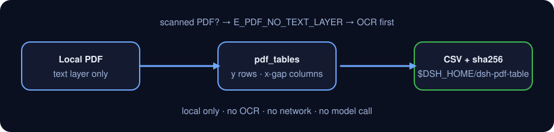

<div align="center">

# dsh-pdf-table

> **Official repository.** The only official repository of this package, maintained by PerryLink. Same-name repositories under other accounts are not affiliated. Apache-2.0.

[](https://www.npmjs.com/package/dsh-pdf-table)
[](https://github.com/PerryLink/dsh-pdf-table/actions)
[](LICENSE)

**Extract tables from a PDF text layer → CSV. No OCR; scanned PDFs are not supported.**

> **Status: alpha / public-synthetic / partial / not counted / not GA.** No customer data, customer evidence, or production-readiness claim.

[English](README.md) · [简体中文](README-zh.md)

```sh
dsh plugin --profile <profile> add dsh-pdf-table
```

</div>

## One-liner

Turn the table inside a text-based PDF into rows and columns, then export a quoted CSV.

> Text layer only, no OCR. **Scanned (image-only) PDFs are not supported; OCR them first** and run the tool on the resulting text PDF.

## Fit / not a fit

- **Fits:** PDFs exported from Word, Excel or report writers that carry a real text layer; one table per page, or pages that share the same column layout; moving a table into CSV for reconciliation, loading or archiving.
- **Does not fit:** scans, photos and image-only PDFs (no text layer); merged cells, cells spanning pages, rotated pages, multi-column prose mixed with tables; layout reconstruction of fonts, colours, borders or formulas; replacing a human check of amounts or units.

## Input

- A local `.pdf` path. The file must have a text layer; run `pdf.inspect` first if unsure.
- A single file up to roughly 50 MB is a sensible local limit. `pages` selects 1-based pages.
- The PDF is read-only and never modified.
- **Scanned PDFs are not supported**: a missing text layer raises `E_PDF_NO_TEXT_LAYER` and asks for OCR.

## Output

- `pdf.inspect`: `{ pages, chars_per_page, total_chars, has_text_layer, pages_without_text }`.
- `pdf.tables`: `{ tables: [{ page, rows: string[][] }], rows }`. Items on the same y form a row; x gaps define columns.
- `pdf.to_csv`: CSV path, `sha256`, row/byte counts and exported pages. The file goes to `$DSH_HOME/dsh-pdf-table/exports/`; the source PDF is untouched.

## Example

Paste this one line into the agent:

> 把这个 PDF 里的表格提取成 CSV，保留原来的行列结构。

Reproduce the bundled sample and compare with the golden file:

```sh
node samples/quickstart/run.mjs --check
```


The sample PDF is a tiny code-generated file: a 3-row × 4-column table plus one prose line. `samples/quickstart/expected/result.json` is the real stdout of `node samples/quickstart/run.mjs --json`, not hand-written. The header `Q1 "units"` and the cell `South, East` deliberately exercise both CSV quote rules.

## Permissions

Read: the PDF the user names (sample: `samples/quickstart/input/table-demo.pdf`); nothing else.
Write: `$DSH_HOME/dsh-pdf-table/exports/` only; the source PDF is not modified.
Network: no.
External systems: none.

`pdf.inspect` and `pdf.tables` are **R0** (read-only). `pdf.to_csv` is **R1** (local write under `$DSH_HOME/dsh-pdf-table`). `DSH_PDF_TABLE_HOME` can override the local write root for tests; the default is exactly `$DSH_HOME/dsh-pdf-table`.

## FAQ

### 1. Can it read a scanned PDF?

No. This package reads the text layer and **does not OCR**. A scan fails with `E_PDF_NO_TEXT_LAYER`; OCR it first, then run `pdf.inspect` again.

### 2. Why is a column merged or split?

Columns come from x gaps between text items. Narrow gaps, several text runs inside one cell, or two tables with different layouts on the same page can merge or split columns. Inspect `pdf.tables` output and use `pages` to export one page at a time when needed.

### 3. Are commas and quotes in cells safe?

Yes. Fields containing a comma, a double quote, CR or LF are quoted and embedded quotes are doubled (RFC 4180). The sample covers both `South, East` and `Q1 "units"`.

### 4. Does it modify or upload my PDF?

No. It reads the named PDF, writes only under `$DSH_HOME/dsh-pdf-table/exports/`, and never uses the network or a model call.

## Version

`0.1.0-alpha.1` · 31 tests pass (`node --test test/*.test.mjs`).

> ⭐ If this helps, a star makes it easier for the next person to find it. Nothing is gated behind it.



*Workflow: local PDF → text-layer coordinate clustering → local CSV. No model call.*

## Install

```sh
dsh plugin --profile <profile> add dsh-pdf-table
dsh --profile <profile> --dump-config | grep dsh-pdf-table
```

Uninstall:

```sh
dsh plugin --profile <profile> remove dsh-pdf-table
```

### Install channels

- **npm (recommended):** `dsh plugin --profile <profile> add dsh-pdf-table`
- **git channel:** `dsh plugin --profile <profile> add github:PerryLink/dsh-pdf-table`
- **tarball:** `pnpm pack`, then `dsh plugin --profile <profile> add ./dsh-pdf-table-<version>.tgz`

## Tools

Tool names are stable API; descriptions stay in English to match runtime output.

| Tool | Purpose | Risk |
|---|---|---|
| `pdf.inspect` | Page count, text characters per page, text-layer presence; no text layer raises `E_PDF_NO_TEXT_LAYER` | R0 |
| `pdf.tables` | Cluster text items by y into rows and x gaps into columns; returns `{ page, rows }` per page | R0 |
| `pdf.to_csv` | Write quoted CSV and return path + sha256 | R1 local write |

### Row/column rules used by `pdf.tables`

1. Drop whitespace-only items, sort by y descending; items within 3pt share a row.
2. Sort each row by x; gaps above 6pt start a new cell, smaller gaps merge.
3. Cluster cell x starts across the page with an 18pt tolerance; pad short rows.
4. Rows with a single text block are prose and are skipped.

This is a text-layer heuristic, not a layout-analysis engine. See the limits below.

## Quick start

```sh
# 1) page count + text layer
#    tool surface: pdf.inspect({ path: "/abs/path/report.pdf" })

# 2) extract table rows
#    tool surface: pdf.tables({ path: "/abs/path/report.pdf", pages: [1] })

# 3) export CSV
#    tool surface: pdf.to_csv({ path: "/abs/path/report.pdf", filename: "report.csv" })
```

Or run the sample:

```sh
node samples/quickstart/run.mjs --check
```

## Acceptance evidence

Public/synthetic fixtures live in `samples/quickstart/`; `ACCEPTANCE.csv` records the checks. Every row is `counted=false` except the quickstart row.

| req_id | metric | threshold | actual | pass | source | counted |
|---|---|---|---|---|---|---|
| PDF-A02 | table 3x4 | 3 rows x 4 cols | 3 rows x 4 cols | true | public/synthetic | false |
| PDF-A04 | CSV quoting | comma+quote escaped | escaped | true | public/synthetic | false |
| PS1-QS01 | quickstart golden | 1/1 | 1 | true | synthetic/quickstart | true |

*Fixture-backed rows, not a customer run; no output is invented.*

## Limits and known limitations

- **No OCR:** image-only PDFs must be OCR'd first.
- Coordinate clustering only: merged cells, cross-page cells, rotated pages, vertical text and multi-column prose may be misread.
- One column set per page: two differently shaped tables on the same page can be merged into one column set.
- No numeric/unit/formula validation; fonts, colours and borders are not reconstructed.
- CSV uses RFC 4180 quote escaping only; Excel formula prefixes are not sanitised.
- Local only: no network, no model call, no upload.
- Public/synthetic samples only; alpha/partial, not counted, no GA or production-readiness claim.

## Development

```sh
pnpm install --frozen-lockfile
pnpm build && pnpm lint && pnpm typecheck
node --test test/*.test.mjs
node scripts/gate.mjs
```

## Compatibility

| Surface | Status |
|---|---|
| Harness | `dsh >=0.2.1-rc.3 <0.4.0` |
| Node | `>=24.9.0 <25` |
| Platforms | All; local files only |
| Data | No network, no model call, no upload |

## Related work

- [dsh-ghg](https://github.com/PerryLink/dsh-ghg) (also reads PDF text with pdfjs-dist)
- [dsh-pim-lint](https://github.com/PerryLink/dsh-pim-lint) (CSV validation tools)
- [Domain index](https://perrylink.github.io/dsh-plugins/)

## License

Apache-2.0. See `LICENSE`, `NOTICE`, `THIRD-PARTY-NOTICES`.
