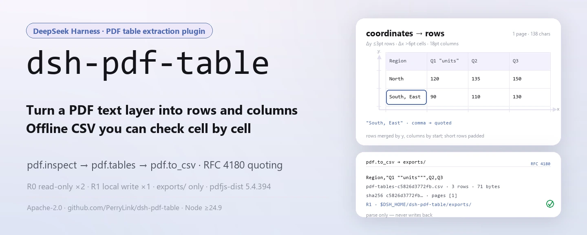
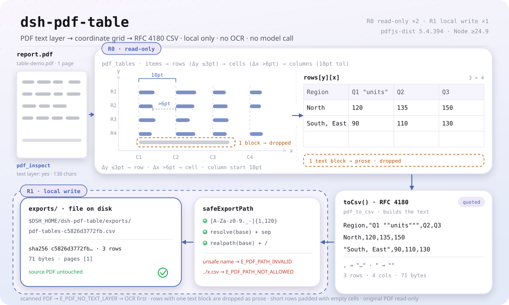

<div align="center">

<picture>
  <source media="(prefers-color-scheme: dark)" srcset="docs/assets/dsh-pdf-table-hero-en-dark.webp">
  
</picture>

# dsh-pdf-table

**Transforme a tabela de um PDF com camada de texto em linhas e colunas e exporte um CSV que dá para conferir.**

Extrator de tabelas de PDF totalmente local para o DeepSeek Harness: `pdf.inspect` verifica se existe camada de texto, `pdf.tables` reconstrói linhas e colunas a partir das coordenadas e `pdf.to_csv` grava um CSV com aspas — sem rede, sem chamada ao modelo, sem upload e sem OCR.

[Instalar](#instalação-em-três-passos) · [Configuração](#configuração) · [FAQ](#faq) · [简体中文](README.md) · [English](README.en.md) · [Español](README.es.md) · [Português](README.pt.md) · [हिन्दी](README.hi.md)

[](LICENSE)
[](#compatibilidade)
[](https://www.npmjs.com/package/dsh-pdf-table)
[](https://github.com/PerryLink/dsh-pdf-table/actions/workflows/ci.yml)
[](#compatibilidade)

[](https://github.com/PerryLink/dsh-pdf-table/stargazers)
[](https://www.npmjs.com/package/dsh-pdf-table)

```sh
dsh plugin --profile <profile> add dsh-pdf-table
```

</div>

<sub>Plugin da comunidade, sem afiliação com a DeepSeek. Repositório canônico: <https://github.com/PerryLink/dsh-pdf-table> (não há outro espelho oficial).</sub>

<sub>Status: alpha / public-synthetic / partial / not counted / não GA. Sem dados de clientes, sem evidência de clientes e sem declaração de prontidão para produção.</sub>

## O que é

Em uma frase: lê a **camada de texto** de um PDF local, reconstrói a tabela a partir das coordenadas dos itens de texto e exporta um CSV com escape de aspas RFC 4180. Não faz OCR, não analisa layout, não reconstrói fontes nem bordas e não confere valores ou unidades por você — só transforma «texto disposto em linhas e colunas em uma página» em «um CSV que outra pessoa consegue conferir».

<picture>
  <source media="(prefers-color-scheme: dark)" srcset="docs/assets/dsh-pdf-table-flow-v5-dark.svg">
  6pt e seus inícios agrupam-se com tolerância de 18pt nas colunas C1-C4; linhas curtas são preenchidas e uma linha de bloco único é descartada como prosa, gerando uma grade rows[y][x] 3x4. toCsv() aplica o escape RFC 4180, o texto cruza a fronteira de escrita R1 por safeExportPath (lista branca de nome + realpath) até $DSH_HOME/dsh-pdf-table/exports/ e volta com um recibo sha256">
</picture>

- **Serve:** PDFs exportados do Word, Excel ou de geradores de relatório com camada de texto real; uma tabela por página, ou páginas com o mesmo layout de colunas; levar uma tabela para CSV para conciliação, carga ou arquivamento.
- **Não serve:** digitalizações, fotos e PDFs só de imagem (sem camada de texto); células mescladas, células que cruzam páginas, páginas giradas, prosa em duas colunas misturada com tabelas; reconstrução de fontes, cores, bordas ou fórmulas; substituir a conferência humana de valores ou unidades.

```text
report.pdf ──pdf.inspect──▶ pages · chars_per_page · has_text_layer      (R0 somente leitura)
           ──pdf.tables──▶  rows[y][x]: y a 3pt = linha, vão de x > 6pt = célula  (R0 somente leitura)
           ──pdf.to_csv──▶  exports/*.csv + sha256 (escape RFC 4180)       (R1 escrita local)
```

As três ferramentas formam um único pipeline local: sem OCR, sem requisição de rede, sem chamada ao modelo e com o PDF original somente leitura do começo ao fim.

## Instalação em três passos

1. **Instalar** (escolha um canal):

   ```sh
   # canal npm (recomendado, versões publicadas)
   dsh plugin --profile <profile> add dsh-pdf-table
   # canal git (main mais recente; equivale a git+https://github.com/PerryLink/dsh-pdf-table.git)
   dsh plugin --profile <profile> add github:PerryLink/dsh-pdf-table
   # canal tarball: depois de pnpm pack neste repositório
   dsh plugin --profile <profile> add ./dsh-pdf-table-<version>.tgz
   ```

   O canal npm traz o `lib/` compilado; os canais git e tarball trazem o código-fonte e, como este pacote não tem script `prepare`, você precisa de `pnpm install && pnpm build` no repositório para gerar o `lib/` (também antes de empacotar um tarball).

2. **Configuração mínima** (não há chaves Config; uma linha montada basta):

   ```yaml
   - insert:
       - id: dsh-pdf-table
         name: dsh-pdf-table
   ```

3. **Verificar que funciona**:

   ```sh
   dsh --profile <profile> --dump-config | grep dsh-pdf-table
   node samples/quickstart/run.mjs --check
   ```

   O segundo comando roda dentro do repositório; se imprimir `quickstart ok`, extração e escape do CSV estão corretos.

**Desinstalar**: `dsh plugin --profile <profile> remove dsh-pdf-table` (ou remova a linha do patch de perfil).

## Capacidades principais

Os nomes das ferramentas são API estável; as descrições ficam em inglês para combinar com a saída em tempo de execução.

| Ferramenta | Uso | Risco |
|---|---|---|
| `pdf.inspect` | Número de páginas, caracteres de texto por página e presença de camada de texto; sem camada de texto lança `E_PDF_NO_TEXT_LAYER` | R0 |
| `pdf.tables` | Agrupa itens por y em linhas e por vãos de x em colunas; devolve `{ page, rows }` por página | R0 |
| `pdf.to_csv` | Grava o CSV com aspas e devolve caminho + sha256 | R1 escrita local |

- **Agrupamento por coordenadas da camada de texto** — itens no mesmo y (≤3pt) formam uma linha, vãos de x acima de 6pt abrem uma célula nova e os inícios de célula são agrupados em colunas com tolerância de 18pt; linhas com um único bloco de texto são tratadas como prosa e descartadas.
- **Dois níveis de risco** — `pdf.inspect` e `pdf.tables` são R0 (somente leitura); `pdf.to_csv` é R1 (escrita local) e sempre grava sob `$DSH_HOME/dsh-pdf-table/exports/`.
- **Caminho de exportação controlado** — o nome do arquivo precisa casar com `[A-Za-z0-9._-]{1,120}`; `../`, separadores de caminho e fuga por link simbólico são rejeitados (`E_PDF_PATH_INVALID` / `E_PDF_PATH_NOT_ALLOWED`).
- **Escape de aspas no CSV** — campos com vírgula, aspas duplas, CR ou LF são envolvidos em aspas e as aspas internas são duplicadas (RFC 4180).
- **Recibo sha256** — `pdf.to_csv` devolve caminho, `sha256`, número de linhas, bytes e as páginas realmente exportadas, para conferência item a item.
- **Erros com o próximo passo** — nove códigos `E_PDF_*` estáveis, no formato `<uma frase humana>（E_PDF_XXX）｜下一步：<uma ação>`; veja «Códigos de erro».

### Regras de linhas e colunas do `pdf.tables`

1. Itens só com espaço são descartados e a ordenação é por y decrescente; itens a ≤3pt compartilham a linha.
2. Cada linha é ordenada por x; vão acima de 6pt abre célula nova, vãos menores são fundidos.
3. Inícios de célula da página inteira são agrupados em colunas com tolerância de 18pt; linhas curtas são preenchidas.
4. Linhas com um único bloco de texto são prosa e são ignoradas.

É uma heurística sobre a camada de texto, não um motor de análise de layout; os limites estão abaixo. *Observed from `src/core/pdf.ts:274-276`*

## Entrada

- Caminho local de um `.pdf`. O arquivo precisa ter camada de texto; em dúvida, rode `pdf.inspect` antes.
- Um arquivo de até cerca de 50 MB é um limite local razoável (recomendação, não um limiar fixo no código). `pages` seleciona páginas com base 1.
- O PDF é somente leitura e nunca é modificado.
- **PDFs digitalizados não são suportados**: a ausência de camada de texto lança `E_PDF_NO_TEXT_LAYER` e pede OCR.

## Saída

- `pdf.inspect`: `{ pages, chars_per_page, total_chars, has_text_layer, pages_without_text }`.
- `pdf.tables`: `{ tables: [{ page, rows: string[][] }], rows }`; itens no mesmo y formam uma linha, vãos de x definem colunas e o texto das células é aparado.
- `pdf.to_csv`: `{ path, sha256, rows, bytes, pages }`. O arquivo vai para `$DSH_HOME/dsh-pdf-table/exports/` com o nome padrão `pdf-tables-<12 primeiros caracteres do sha256>.csv`; o PDF original não é tocado.

## Exemplo

Cole esta linha no agente:

```text
把这个 PDF 里的表格提取成 CSV，保留原来的行列结构。
```

Reproduza o exemplo incluído e compare com o arquivo dourado:

```sh
node samples/quickstart/run.mjs --check
```

Saída real (captura: [`docs/assets/quickstart.png`](docs/assets/quickstart.png); log: [`docs/assets/quickstart.log`](docs/assets/quickstart.log)):

```text
dsh-pdf-table quickstart - synthetic text-layer PDF (no OCR, not customer data)
1 page, 138 text chars; text layer yes
table: 3 rows x 4 columns on page 1
header: Region | Q1 "units" | Q2 | Q3
row: North | 120 | 135 | 150
row: South, East | 90 | 110 | 130
CSV exports/table-demo.csv: 3 rows, 71 bytes, sha256 c5826d3772fb...
CSV escaping: comma -> "South, East"; quote -> "Q1 ""units"""
golden samples/quickstart/expected/result.json matches
quickstart ok
```


O CSV exportado é exatamente o campo `csv.text` do arquivo dourado `samples/quickstart/expected/result.json`:

```csv
Region,"Q1 ""units""",Q2,Q3
North,120,135,150
"South, East",90,110,130
```

O PDF de exemplo é um arquivo mínimo gerado por código: uma tabela de 3 linhas × 4 colunas mais uma linha de prosa. O cabeçalho `Q1 "units"` e a célula `South, East` contêm de propósito aspas e vírgulas para exercitar as duas regras de aspas do CSV; a linha de prosa é descartada pela regra «um único bloco de texto = prosa». O dourado é a saída real de `node samples/quickstart/run.mjs --json`, não é escrito à mão.

Chamadas na superfície de ferramentas:

```sh
# 1) número de páginas e camada de texto
#    superfície: pdf.inspect({ path: "/abs/path/report.pdf" })

# 2) extrair as linhas da tabela
#    superfície: pdf.tables({ path: "/abs/path/report.pdf", pages: [1] })

# 3) exportar CSV
#    superfície: pdf.to_csv({ path: "/abs/path/report.pdf", filename: "report.csv" })
```

## Configuração

Este plugin **não tem chaves Config**: depois de montado, tudo está disponível e a única coisa alterável é aquela linha do patch de perfil. Todos os ajustes ficam nos argumentos das três ferramentas:

| Ferramenta | Argumento | Obrigatório | Significado |
|---|---|---|---|
| `pdf.inspect` | `path` | sim | Caminho absoluto do PDF a inspecionar |
| `pdf.tables` | `path` | sim | Caminho absoluto do PDF a extrair |
| `pdf.tables` | `pages` | não | Array de páginas com base 1; omitido = todas; array vazio ou página fora do intervalo lança `E_PDF_PAGE_RANGE` |
| `pdf.to_csv` | `path` | sim | Caminho absoluto do PDF a exportar |
| `pdf.to_csv` | `pages` | não | Igual ao acima |
| `pdf.to_csv` | `filename` | não | Nome de exportação, apenas `[A-Za-z0-9._-]{1,120}`; padrão `pdf-tables-<12 primeiros caracteres do sha256>.csv` |

Raiz de escrita local: `$DSH_HOME/dsh-pdf-table` (exporta para o `exports/` dela). Em testes dá para sobrescrever com `DSH_PDF_TABLE_HOME`; se `DSH_HOME` não estiver definida, o plugin usa o diretório de trabalho atual (`process.cwd()/dsh-pdf-table`) — *Observed from `src/plugin/index.ts:9-14`*.

## FAQ

<details>
<summary>Dá para ler um PDF digitalizado?</summary>

Não. Este pacote lê a camada de texto e **não faz OCR**. PDF só de imagem falha com `E_PDF_NO_TEXT_LAYER`; passe primeiro por OCR e rode `pdf.inspect` de novo para confirmar que `total_chars > 0`.

</details>

<details>
<summary>Por que uma coluna é unida ou separada?</summary>

Primeiro rode `node samples/quickstart/run.mjs --check` para descartar problema de ambiente. As colunas vêm dos vãos de x entre itens: vãos estreitos, vários itens dentro de uma célula ou duas tabelas com layouts diferentes na mesma página podem unir ou separar colunas. Confira as `rows` de `pdf.tables` e use `pages` para exportar uma página de cada vez quando precisar.

</details>

<details>
<summary>Vírgulas e aspas dentro das células são seguras?</summary>

Sim. Campos com vírgula, aspas duplas, CR ou LF são envolvidos em aspas e as aspas internas são duplicadas (RFC 4180). O exemplo cobre `South, East` e `Q1 "units"`. Atenção: este pacote só faz escape de aspas, não limpa prefixos de fórmula do Excel.

</details>

<details>
<summary>Ele modifica ou envia meu PDF?</summary>

Não. Lê o PDF indicado, grava apenas sob `$DSH_HOME/dsh-pdf-table/exports/` e nunca usa a rede nem chama modelo. O sha256 do PDF original serve só para montar o nome padrão; nada é gravado de volta no arquivo.

</details>

<details>
<summary>Qual é o custo de desempenho?</summary>

Cada chamada lê o PDF na memória e analisa a camada de texto com o pdfjs-dist local, sem cache, então o custo cresce com o número de páginas e de itens. Não há requisição de rede, chamada ao modelo ou processo em segundo plano, portanto o custo em repouso é zero. O repositório não publica benchmark de tempo e 50 MB não deve ser tratado como teto rígido: divida o arquivo ou use `pages` se a memória apertar.

</details>

## Limites de segurança

- **O PDF original é somente leitura.** `openPdf` só lê os bytes e calcula o `sha256`; nenhum caminho, com sucesso ou erro, regrava o arquivo de origem.
- **Uma única superfície de escrita.** `pdf.to_csv` sempre grava em `$DSH_HOME/dsh-pdf-table/exports/`; o nome passa por uma lista branca e o caminho resolvido é reconferido com `realpath`, então um link simbólico não consegue tirar a escrita do diretório de exportação.
- **Sem rede e sem modelo.** A análise acontece dentro do processo (pdfjs-dist `5.4.394`): sem fetch, sem serviço externo e sem chamada ao modelo.
- **Falha fechada.** Falta de camada de texto, arquivo corrompido, arquivo vazio, criptografia, páginas fora do intervalo e falhas de escrita lançam um código estável com o próximo passo, em vez de devolver tabela vazia em silêncio.
- **Registro é efeito.** As três ferramentas são registradas em `apply()` e removidas ao parar ou recarregar a quente.

## Permissões e dados

Leitura: o PDF indicado pelo usuário (exemplo `samples/quickstart/input/table-demo.pdf`); nada além.
Escrita: apenas `$DSH_HOME/dsh-pdf-table/exports/` (saída CSV); o PDF original não é modificado.
Rede: não.
Sistemas externos: nenhum.

`pdf.inspect` e `pdf.tables` são **R0** (somente leitura); `pdf.to_csv` é **R1** (escrita local, apenas sob `$DSH_HOME/dsh-pdf-table/exports/`). `DSH_PDF_TABLE_HOME` pode sobrescrever a raiz de escrita local em testes; por padrão é exatamente `$DSH_HOME/dsh-pdf-table`.

## Códigos de erro

| Código | Quando aparece | Próximo passo |
|---|---|---|
| `E_PDF_PATH_INVALID` | Caminho vazio, um diretório, caminho ilegível ou nome de exportação inseguro | Passe um caminho absoluto `.pdf` existente; exporte apenas nomes `[A-Za-z0-9._-]` |
| `E_PDF_NOT_FOUND` | O arquivo não existe | Confira ortografia e maiúsculas do caminho |
| `E_PDF_EMPTY` | Arquivo de 0 byte, ou PDF com zero páginas | Use um PDF não vazio e não danificado |
| `E_PDF_CORRUPT` | Arquivo truncado ou incompleto, ou um `.pdf` que não é PDF | Abra em um leitor e salve uma cópia nova; tente de novo |
| `E_PDF_ENCRYPTED` | Protegido por senha, a camada de texto não é legível | Exporte uma cópia sem senha com a senha de proprietário (este pacote nunca adivinha senhas) |
| `E_PDF_NO_TEXT_LAYER` | PDF digitalizado ou só de imagem, sem caracteres extraíveis | Faça OCR para um PDF com texto e rode de novo |
| `E_PDF_PAGE_RANGE` | `pages` vazio, não inteiro positivo, fora do intervalo ou com página inválida | Comece em 1 e use o `pages` devolvido por `pdf.inspect` |
| `E_PDF_PATH_NOT_ALLOWED` | O caminho de exportação escapa de `exports/` (também após realpath) | Passe apenas um nome de arquivo, sem `../`, separadores ou links simbólicos |
| `E_PDF_EXPORT_FAILED` | Falha de escrita local: diretório sem permissão, disco cheio etc. | Confirme que `$DSH_HOME/dsh-pdf-table` é gravável e tente de novo |

Todas as mensagens têm o formato `<uma frase humana>（E_PDF_XXX）｜下一步：<uma ação>`. Solução por código: [TROUBLESHOOTING.md](TROUBLESHOOTING.md).

## Evidência de aceitação

Os fixtures públicos/sintéticos ficam em `samples/quickstart/`; `ACCEPTANCE.csv` registra as verificações. Todas as linhas são `counted=false`, exceto a do quickstart.

| req_id | metric | threshold | actual | pass | source | counted |
|---|---|---|---|---|---|---|
| PDF-A01 | inspect pages/chars | pages=1 chars>0 | pages=1 chars=129 | true | public/synthetic | false |
| PDF-A02 | table 3x4 | 3 rows x 4 cols | 3 rows x 4 cols | true | public/synthetic | false |
| PDF-A03 | page filter | page 2 only | pages=2 | true | public/synthetic | false |
| PDF-A04 | CSV quoting | comma+quote escaped | escaped | true | public/synthetic | false |
| PDF-A05 | CSV sha256 | matches file | c5826d3772fb | true | public/synthetic | false |
| PDF-A06 | scanned PDF error | E_PDF_NO_TEXT_LAYER | E_PDF_NO_TEXT_LAYER | true | public/synthetic | false |
| PDF-A07 | corrupt PDF error | E_PDF_CORRUPT | E_PDF_CORRUPT | true | public/synthetic | false |
| PDF-A08 | empty PDF error | E_PDF_EMPTY | E_PDF_EMPTY | true | public/synthetic | false |
| PDF-A09 | export path safety | traversal rejected | E_PDF_PATH_INVALID | true | public/synthetic | false |
| PS1-QS01 | quickstart golden | 1/1 | 1 | true | synthetic/quickstart | true |

*Linhas respaldadas por fixtures, não uma execução de cliente; nenhuma saída é inventada.*

## Limitações conhecidas

- **Sem OCR:** PDFs só de imagem precisam passar por OCR antes.
- Apenas agrupamento por coordenadas: células mescladas, células entre páginas, páginas giradas, texto vertical e prosa em várias colunas podem ser lidos errado.
- Um único conjunto de colunas por página: duas tabelas de formatos diferentes na mesma página podem virar um só conjunto.
- Sem validação de números, unidades ou fórmulas; fontes, cores e bordas não são reconstruídas.
- O CSV só aplica escape de aspas RFC 4180; prefixos de fórmula do Excel não são limpos.
- Apenas local: sem rede, sem chamada ao modelo, sem upload.
- Apenas amostras públicas/sintéticas; alpha/partial, not counted, sem declaração de GA ou prontidão para produção.

## Interoperabilidade

- **Depende só do serviço `tools`** (`inject = ['tools']`): o plugin carrega quando o perfil compõe tools e não expõe chaves de serviço, então conflitos de chave de serviço são impossíveis.
- **Nomes de ferramenta com prefixo `pdf.`**: não ocupa nenhum nome simples embutido. Se outro plugin também registrar ferramentas `pdf.*`, isso sim é colisão real de nomes: confira a superfície de ferramentas com `dsh --profile <profile> --dump-config` antes de instalar.
- **Sem metade de navegador**: o manifesto não declara `dsh.client` (`scripts/lint.mjs` afirma `!pkg.dsh?.client`), então não registra slot de cliente nem disputa assentos de UI.
- **Sem rotas HTTP**: não registra prefixos `webServer` nem escuta porta alguma.
- **O patch só insere a si mesmo**: `cordis.patch.yml` tem uma única linha `insert`; nunca sobrescreve linhas embutidas nem altera objetos globais.

## Compatibilidade

| Dimensão | Estado |
|---|---|
| Harness | `dsh >=0.2.1-rc.3 <0.4.0` |
| Node | `>=24.9.0 <25` |
| Plataformas | Todas; apenas arquivos locais |
| Dados | Sem rede, sem chamada ao modelo, sem upload |

## Ecossistema e qualidade

- [Índice de domínio](https://perrylink.github.io/dsh-plugins/) (visão da família, navegação por tarefa e versões dos pacotes)
- [Página do pacote no npm](https://www.npmjs.com/package/dsh-pdf-table) (versão, downloads e dependência)
- [Repositório no GitHub](https://github.com/PerryLink/dsh-pdf-table) (issues, Actions e releases)
- Dependência de execução [pdfjs-dist](https://www.npmjs.com/package/pdfjs-dist) `5.4.394` (só analisa a camada de texto localmente, sem requisição de rede)

## Trabalhos relacionados

- [dsh-ghg](https://github.com/PerryLink/dsh-ghg) (também lê texto de PDF com pdfjs-dist)
- [dsh-pim-lint](https://github.com/PerryLink/dsh-pim-lint) (ferramentas de validação de CSV)

## Desenvolvimento

```sh
pnpm install --frozen-lockfile
pnpm build && pnpm lint && pnpm typecheck
node --test test/*.test.mjs
node scripts/gate.mjs
```

Versão atual `0.1.0`, 31 testes passando (`node --test test/*.test.mjs`). Portão de publicação: `node scripts/gate.mjs` (lint de metadados + todas as linhas públicas de aceitação).

| Caminho | Conteúdo |
|---|---|
| `src/core/pdf.ts` | Carregamento do pdfjs, itens de texto, agrupamento em linhas/colunas e nove códigos estáveis |
| `src/core/csv.ts` | Escape de campos RFC 4180 e montagem do CSV |
| `src/core/safe-path.ts` | Lista branca de nomes e checagem de fuga de diretório |
| `src/plugin/index.ts` | `resolveBaseDir` (`DSH_PDF_TABLE_HOME` / `DSH_HOME`) e `apply` |
| `src/plugin/tools.ts` | Superfície de `pdf.inspect` / `pdf.tables` / `pdf.to_csv` |
| `test/*.test.mjs` | 31 casos de `node --test` (CSV, PDF, caminhos, fumaça do plugin, quickstart) |
| `samples/quickstart/` | PDF sintético, dourado `expected/result.json` e script de repetição |
| `docs/assets/` | Diagramas e a saída real de terminal (`quickstart.png` / `quickstart.log`) |

O hero de abertura e o diagrama de estrutura de «O que é» são gerados por [`scripts/gen-readme-assets.py`](scripts/gen-readme-assets.py): o hero é desenhado com Pillow em `docs/assets/dsh-pdf-table-hero-{zh,en}-{light,dark}.webp` (1440×576) e o diagrama é SVG escrito à mão em `docs/assets/dsh-pdf-table-flow-v5-{light,dark}.svg` (1100×660, só tokens de comando, compartilhado pelos cinco idiomas). Reproduzível com `python scripts/gen-readme-assets.py` (aborta se faltar uma fonte ou se um rótulo não couber na caixa). `docs/assets/quickstart.png` é uma captura real mantida junto de `docs/assets/quickstart.log`; o antigo `docs/assets/dsh-pdf-table-flow.svg` e seu par claro/escuro ficam para que links antigos não deem 404, enquanto o README usa o hero e o flow-v5.

Topics: `dsh`, `dsh-plugin`, `deepseek-harness`, `deepseek`, `pdf`, `table`, `csv`, `pdfjs`, `perrylink`

## Família e agradecimentos

Este projeto é membro da família de plugins do DeepSeek Harness mantida pela [PerryLink](https://github.com/PerryLink) (todos Apache-2.0). Se este plugin ajudar você, **deixe uma estrela**: ela não desbloqueia nada, mas faz a próxima pessoa encontrá-lo mais rápido.

- [@PerryLink](https://github.com/PerryLink) — criador e mantenedor: agrupamento por coordenadas da camada de texto, as três ferramentas, o exemplo dourado do quickstart e a documentação em cinco idiomas.

## Licença

[LICENSE](LICENSE) (Apache License 2.0) © 2026 dsh-pdf-table contributors. Veja também `NOTICE` e `THIRD-PARTY-NOTICES`.

<p align="center"><sub>Apache-2.0 · Plugin da comunidade, sem afiliação com a DeepSeek.</sub></p>
